# Fiona Global Coverage Engine 6:3:1

- Version: V3.1-alpha.2
- Status: Gate 2.2 remediation; production legacy; Gate 2 OPEN
- Owner: Fiona Engineering
- Updated: 2026-10-09

## 1. Product Rule

The long-run editorial target is US & Europe 60%, Greater China 30%, and Rest of
World 10%. This is a dynamic weighting target, not a hard quota. A material
event is never suppressed merely because its region is already represented.

## 2. Architecture

```mermaid
flowchart LR
    Registry[Canonical Source Registry] --> Collectors[Bounded Public Collectors]
    Collectors --> Provenance[Original Provenance]
    Provenance --> Normalize[Deterministic Normalization]
    Normalize --> Region[Event Region]
    Region --> Cluster[Dedup + Event Clustering]
    Cluster --> Materiality[Materiality + Quality Floor]
    Materiality --> Rank[Dynamic 6:3:1 Ranking]
    Rank --> Shadow[Shadow Selection + Metrics]
    Shadow --> Authority[Central Coverage Authority]
    Legacy[Legacy Selection] --> Authority
    Authority -->|production legacy unchanged| Telegram[Existing Telegram Content]
    Authority -. global_631 implemented but inactive .-> Presentation[Existing Market News Pipeline]
    Shadow -. no content mutation .-> Observability[24H / 7D Observability]
```



## 3. Canonical Regions

- `US_EU`
- `GREATER_CHINA`: Mainland China, Hong Kong, and Taiwan
- `REST_OF_WORLD`
- `GLOBAL`
- `UNKNOWN`

The event determines region. Precedence: explicit event geography; named
institution/regulator jurisdiction (including identified official primary-source
identity); affected market; known entity jurisdiction; explicit global semantics;
UNKNOWN. Multiple credible jurisdictions at a level stay GLOBAL. Within a level,
headline evidence precedes snippet evidence. Publisher/default region never fills
an evidentiary gap. Generic Chinese `央行` is not evidence of China jurisdiction.
Keyword mention is a conservative heuristic, not entity-role proof; ambiguous
cross-border stories still require editorial review.

## 4. Event and Provenance Contract

`NormalizedCoverageEvent` preserves source ID/name/URL, original language,
original title/snippet, published and retrieved timestamps, publisher region,
event region, source tier, and independence group. Stable IDs are SHA-256 based
and deterministic; an LLM is not used for identity, region, clustering, score,
or routing.

## 5. Clustering and Deduplication

The bounded algorithm uses canonical URL, source identity, independence group,
category, time distance, entities, and normalized token similarity. It handles:

- exact URL duplicates;
- same-source repeats;
- syndicated repeats;
- near-duplicate headlines;
- independent confirmation of one underlying event.

Duplicate articles remain auditable in a cluster but do not inflate independent
confirmation. Cluster IDs are deterministic for the same event set and stable
across input ordering. No embeddings, vector database, or PostgreSQL are used.

Except for an exact article URL, matches require publication proximity within
36 hours. Annual releases with identical titles and distinct URLs remain
separate. Missing article links stay empty, not the shared feed URL. Identical
substantial snippets across publishers count as syndication; owner, article URL,
and copy identity are unioned before counting independent evidence. These are
conservative heuristics, not proof of independent reporting.

## 6. Freshness and Materiality

Freshness uses `published_at` separately from `retrieved_at`. Initial windows
are 96h for macro/regulation, 72h for RWA, 48h for market/other, and 36h for
crypto. Invalid or absent timestamps remain `unknown` and are not selected as
current intelligence.

Gate 2.2 separates authority from materiality. Administrative/calendar/personnel/
educational fraud/procedural releases normally score 18, cross-market 20,
narrative 20. Boilerplate systemic terms in an educational snippet cannot
override that floor. A genuine explicit systemic headline can still qualify.
Other semantic base scores: exceptional/systemic 92; actual policy-rate action
75; inflation/employment/GDP data 70; material policy/trade/regulatory action
65; geopolitical incident 58; relevant category 40; other 25.
Surprise adds 10 (except already exceptional). Existing inferred market breadth
adds 12% as before, bounded at 100. Source tier contributes zero to event
materiality; cluster independent confirmation still adds at most 12.
Override requires explicit exceptional semantics, or surprise plus score >=85,
not mere official authority. Override never bypasses validity or freshness.
These remain heuristics: a keyword-derived number is not measured market impact.
Forward-looking previews containing macro words remain an editorial-review risk.

## 7. Ranking

Initial base score:

```text
46% materiality
13% cross-market impact
15% freshness
10% source-tier authority
 8% independent confirmation
 8% narrative relevance
```

A soft regional-deficit adjustment is then applied during deterministic greedy
selection. Equal-quality, sufficiently deep candidate pools converge near
6:3:1. Better events can override the target. A cluster must pass the quality
floor (materiality >=40 AND quality >=50), nonempty headline, positive freshness,
and non-stale checks BEFORE weighting. Regional adjustment is
`clamp(target - current_share, -0.15, 0.60) * 8`, bounded [-1.2, +4.8],
instead of the original [-6, +24]. A large materiality gap cannot be filled by
regional demand alone. Overrides retain +100 only after validity checks.
Missing qualified regional events remain
underweight and receive an explicit `regional_gap_reason`.

## 8. Shadow Isolation

`FIONA_COVERAGE_PROFILE` accepts `legacy` and `global_631`; invalid values warn
and resolve to `legacy`. Gate 2.2 adds `fiona_coverage_authority` as a single
Market News selection boundary BEFORE presentation. Legacy preserves existing
payload and Alert processing. Global selection projects the same evaluated
clusters into the existing FionaEvent presentation contract, without executing
Alert processing again. Narrative projection is in-memory, not another persisted
narrative history. Operational engine failure or invalid selection falls back
once to legacy; one source outage, underweight regions or a valid empty edition
do not cause fallback. No second sender, renderer, occurrence or ledger is added.
Production remains legacy: activating global_631 requires separate Product Review.
Top-level metrics: configured_coverage_profile, selection_authority,
coverage_fallback_used/reason, selected_cluster_count (global-authoritative
clusters only; zero for legacy). The standalone Shadow evaluator remains
read-only with respect to public selection.

Per-evaluation metrics include candidate/qualified/selected counts, regional
and tier distributions, unknown share, source/independence diversity, duplicate,
syndication and stale rejection, material overrides, coverage gaps, and
confirmation distribution.

## 9. Persistence and Observation

Shadow history retains 21 days locally and exposes rolling 24h/7d summaries.
On Railway without a Volume, this JSON file is **ephemeral**, not durable memory.
Structured deployment logs are therefore required evidence during alpha. No
Railway Volume is introduced in Gate 2.

Activation requires at least 14 days of Shadow observation and 100 qualified
clusters, plus reviewer checks for false positives, missed material events,
source health, regional quality, and licensing/access. A single edition cannot
prove 6:3:1 compliance.

## 10. Safe Validation

```bash
python3 -m app.fiona_runtime validate-source-registry
python3 -m app.fiona_runtime validate-global-coverage
```

The coverage validator fetches public candidates, normalizes, clusters, and
ranks in memory. It reports `telegram_api_calls=0`, `ledger_mutations=0`, and
`formal_occurrences_created=0`.

## 11. Operational Boundaries

Market News evaluates coverage once before presentation. Expanded adapters use
six workers, a 12-second socket timeout,
4 MiB response cap and 50 normalized items per source. Socket timeout is not a
hard whole-evaluation deadline; slow streaming/DNS and clustering remain latency
risks to monitor. No retry storm or additional user-facing occurrence is added.
Missing JSON paths and non-feed XML are classified as invalid responses, not
empty news. TLS validation and access restrictions are never bypassed.

The observation count deduplicates overlapping cluster event IDs across runs.
Rolling regional shares are edition-weighted; source diversity is explicitly an
average of per-evaluation diversity. Stored history contains metrics, safe
source health and hashed event membership, not headlines or article bodies.
Neither local validators nor mock runs establish production observation start.
Occurrence logging emits one compact aggregate record, one bounded health
summary, and up to 10 compact selected-event records. Complete safe audits stay
in the existing archive/history; emitted omissions are counted. Scheduler stdout
is compact and references Shadow evaluation IDs instead of reprinting nested
audit trees. Cadence, arbitration, returned status and ledger are unchanged.
Confirmation sufficiency distinguishes authoritative_primary_source,
single_secondary_source, and multi_independent_confirmation; this is internal
audit metadata, not a new user-visible label or Confirmed Fact claim.
