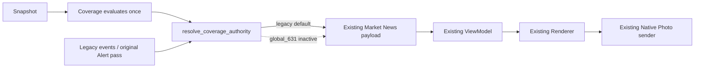

# Gate 2.2 — Editorial Quality Remediation

日期：2026-10-09。负责人：Wilson / Codex。
父 Gate：OPEN / PASS WITH CONDITIONS。Gate 3：LOCKED。
生产覆盖：legacy；本任务不激活 global_631。

## 修改前根因与证据

基线：b74302f7000ac42147205ec53e6a6b16d3050c47。

1. 35 个日历日观察已达标；不重新起算。
2. 保留的 21 天窗口有 1,626 个去重 qualified clusters，超过 100；不是全历史总数。
3. 全球来源供给明显增加：34 份保留的真实 Market News 归档包含 14,007 个候选。
4. Shadow 隔离已通过：归档中的额外发送、ledger mutation、额外 occurrence 均为 0。
5. 编辑质量未通过激活验收，数量达标不等于产品验收通过。
6. 例行通知被抬高：materiality_for 把 Tier 1 的 24 分、政策词的 31 分、来源默认 macro 类别与跨市场先验相加；MPC 日历和真实利率决议可同为 63 分。
7. infer_event_region 缺少 Ukraine / Russia 地理词，无法识别时直接返回 source.default_event_region；SCMP 的 China 默认会把无地理命中的事件分到 Greater China。Oct 9 Ukraine 标题被如此分类。原摘要未保留，不能声称重建了当时完整输入。
8. 340 个被选事件均为单独立来源，真实多源确认仍无充分生产证据；不能把 Tier 1 当作多源确认。
9. HKMA 21/34 成功，13 次超时，61.8%：UNHEALTHY / ISOLATED。无已证实的低风险连接器根因，不重写。
10. run_once 硬编码 coverage_selection_authority=legacy；Shadow 位于 build_payload 之后，没有权威事件集接入点。
11. scheduler stdout 使用缩进 JSON，嵌套重复完整 Shadow 结果；最新生产日志报告约 539 条丢弃。不是每个候选单独日志，但仍造成多行突发。

## 变更计划与边界

先校验事件地理/机构辖区，不再把媒体来源默认地域当成事件事实。
独立 materiality floor 在地域软权重之前执行；官方身份只影响证据质量。
保留 6:3:1 动态目标，缩小地域调整范围，不设置硬配额。
保持聚类保守规则；补充明确的确认充分性审计，不新增用户标签。
新增集中 coverage authority：仅 Market News 在呈现前解析一次选择；legacy 保持原事件与 Alert 流程。
日志使用单行紧凑摘要，完整安全审计留在已有归档；不改调度行为。

## 历史回放限制

34 份归档仅保存当时被选的 10 条标题和聚合指标，不含全部候选、原摘要或原发布证据。
只能进行已选子集的标题级受限回放，不能宣称重建全候选排名或完整历史覆盖。
不抓取当前网络内容冒充历史输入，不制造 override 生产证据。

## 未决问题

新规则仍是确定性启发式，需后续真实 Shadow 再验收；HKMA 来源健康、真实独立确认、区域供给不足继续监控。
Railway JSON history 未挂载 Volume 时仍为 ephemeral，不在本任务修改持久化架构。
部署不代表激活，Gate 2 不能关闭；禁止创建 GATE_2_CLOSEOUT.md。

## Repository Gate

正确路径：`/Users/mac/Desktop/Wilson AI Lab/Fiona Intelligence Platform/03_Development/fiona-intelligence-system`。
main；HEAD / origin/main / GitHub main 均为基线 b74302f；ahead/behind 0/0。
已有修改 `docs/decisions/decision_log.md` 和 20 类未跟踪本地文档/实验脚本保留原样，全部不暂存。
origin：`https://github.com/wilsonchin-gif/fiona-intelligence-system.git`。
修改前，项目 Python 环境中 381 tests PASS；系统 Python 缺 Pillow，不作为验证环境，不安装依赖。

## 实现 Contract

- 地域顺序：明确事件地理 → 机构/监管辖区（含明确的官方原始来源机构身份）→ 市场 → 强实体 → 明确跨区域 GLOBAL → UNKNOWN。
- 不再使用 publisher_region / default_event_region 生成地域确定性；同级多地域为 GLOBAL，中文通用“央行”不等于中国。
- 行政/日历/人事/教育防骗/程序性项通常 materiality=18，cross-market=20，narrative=20；摘要中的风险背景不能提升教育通知。
- 语义基础分：系统性 92、真实利率决议 75、通胀/就业/GDP 70、重大政策/贸易/监管 65、地缘事件 58、相关类别 40、其他 25。意外加 10，跨市场原先验加 12%，上限 100。
- 官方 tier 不进入事件 materiality；仍在 quality / evidence 中保留权重。分数是 heuristic，不是已测量的经济影响。
- 质量门槛：materiality >=40 AND quality >=50；标题非空、freshness>0、非 stale。全部先于地域调整和 override。
- 地域调整：[-1.2,+4.8]，仍为动态 60/30/10，不设硬配额。重大 override 通过门槛后 +100。
- 聚类算法不放宽；官方+独立报道可形成一个独立数 >=2 的 cluster；同 owner、同 URL、相同转载长片段不重复计独立来源。
- 审计 confirmation_sufficiency：authoritative_primary_source / single_secondary_source / multi_independent_confirmation；不是用户标签或 Confirmed Fact 协议。
- 日志：一条 aggregate、一条最多 50 来源的 health summary、最多 10 条 selected；日志截断数可见，归档投影仍最多 50 条，原始选集不截断。600 候选验证只输出 12 条单行记录。
- stdout 只投影 Shadow evaluation 引用，不重复完整树；returned status / archive / ledger 不改变。
- 每个新历史记录标注 editorial_rules_version=gate2.2，旧观察不能自动成为新模型激活证据。

## Production Bridge

`app/fiona_coverage_authority.py` 是唯一选择边界。global_631 消费实际评估中的 EventCluster，不从日志反推，也不重新抓取/再排序一次。
投影为 FionaEvent，不再次执行 Alert Engine；全球叙事在内存构建，不改其他 Brief 的历史。
重要性使用 cluster materiality，置信度是保守证据启发式，Neutral，不制造方向判断或多源事实确认。
既有 Renderer 会按 importance 展示最多 3 条；Global 的权威事件集合不变，但呈现顺序沿用既有行为。

操作性失败/畸形选集/所有来源不可用：一次 legacy fallback，有原因。
单个来源失败、地域不足、健康来源的合法空选集：不回退。
指标：configured_coverage_profile、selection_authority、coverage_fallback_used/reason、selected_cluster_count（global 权威簇数；legacy 为 0，与 selected_shadow_clusters 区分）。
没有第二个发生项、ledger、render 或 Telegram 发送。

## 历史回放结果

数据：2026-09-06 至 10-09 的 34 个已选池，共 340 条。
只使用归档标题、source ID/tier、既有 cluster ID/独立数和保留的 freshness 判断；不重建原摘要、发布时间或原候选。
每池最多原来的 10 条，重新执行标题级地域/语义规则和排序。因此排名只代表该已选子集，不是全候选结果。
全部原选中 340，回放保留 288，排除 52。地域：US/EU 149、Greater China 45、ROW 47、GLOBAL 7、UNKNOWN 40。
US/EU 在 34/34 日仍有内容，Greater China 28/34，ROW 33/34；不是已证明的完整生产覆盖率。
UNKNOWN 增加是取消虚假来源回退及缺摘要的结果，不强填配额。大中华数量下降说明需新真实 Shadow 验证，不可直接激活。

| 日期 | 标题（截短） | 原 rank→子集新 rank | 地域原→新 | materiality 原→新 | 原选→新选 | 原因 |
|---|---|---|---|---|---|---|
| 09-06 | Scam alert related to banks | 2→排除 | China→China | 55→18 | 是→否 | 教育防骗，不等于系统风险 |
| 09-06 | Senior Appointment at HKMA | 8→排除 | China→China | 55→18 | 是→否 | 例行人事 |
| 09-06 | RBI Weekly Statistical Supplement | 3→排除 | ROW→ROW | 58→18 | 是→否 | 例行统计 |
| 09-18 | Monetary Policy Committee dates for 2027 | 3→排除 | US/EU→US/EU | 63→18 | 是→否 | 未来日历，不是决议 |
| 09-18 | Bank rate maintained at 3.75% | 7→1 | US/EU→US/EU | 63→83 | 是→是 | 真实利率决议 |
| 09-18 | China response to US Congress tariffs | 6→3 | China→GLOBAL | 66→72 | 是→是 | 跨区域贸易政策 |
| 09-30 | Asia stocks fall as yields/oil rise | 3→4 | ROW→ROW | 59→51 | 是→是 | 真实跨市场变化仍保留 |
| 10-09 | Silver Bond fourth interest payment | 2→排除 | China→China | 63→18 | 是→否 | 既定利息支付 |
| 10-09 | Russian bomb blast in east Ukraine | 10→3 | China→ROW | 57→65 | 是→是 | 地缘位置被正确识别 |

原始 34 轮没有保留的重大 override；这里只用中央银行意外决议、系统性金融、重大地缘冲击、重大监管的 deterministic fixtures 验证，不冒称生产证据。
回放仍显示宏观词可抬高前瞻报道、缺摘要导致 UNKNOWN、一些官方讲话意义不明确。这些为 Product Review 条件，不为漂亮比例修改历史。

## 安全验证与测试

本地真实 Pillow / 固定字体渲染，fixture 快照和实际选集投影；不调用 Telegram、不创建真实发生项：

| profile | authority | PNG | bytes | caption | CJK | TG calls | ledger mutations | occurrences | cleanup |
|---|---|---|---|---|---|---|---|---|---|
| legacy | legacy | 1440×1800 | 265050 | 391 | false | 0 | 0 | 0 | success |
| global_631 | global_631 | 1440×1800 | 242452 | 384 | false | 0 | 0 | 0 | success |

新增测试覆盖 58 项要求矩阵，包括地域、材料性、override、独立性、日志、选择入口和旧链路回归。
旧 Gate 2.1 基线断言保留原排名权重/地域 fixture，用于验证审计投影不改排序；新 Gate 2.2 门槛/权重独立测试。日志断言升级到 12 条，失败日志不再让成功选题失败。
完整测试及最终发布边界结果见下方发布记录；不改旧测试来掩盖业务失败。

最终本地验证：新增 59 项专项测试；完整 440 tests PASS；compile PASS；diff whitespace check PASS。
受保护的 scheduler module、ledger、Telegram Service/Delivery、locale、Alert、Briefing、Railway 和 source registry 配置均无 diff。
涉及 run_scheduler 的唯一变化是 stdout serialization，不修改调度行为。
暂存边界为 15 个指定代码/测试/文档文件；不包含 reports、临时回放数据、PNG、.env 或既有本地工作。
发布前已只读确认 production：b74302f、deployment 9b81af84-9e74-4e5b-abcd-95175533c928 SUCCESS、单 RUNNING replica；ledger_load_error=null。
真实环境 coverage/cadence/delta 未设置，分别保持 legacy/legacy/off；photo、en-US、image 已设置。本任务不改任何生产变量。

## 已知风险 / 延后债务

- HKMA 61.8% 成功：保持 UNHEALTHY / ISOLATED，12 秒 socket timeout 和 6 workers；不是整轮硬 deadline，不宣称无任何慢响应风险。
- 34 轮被选事件独立数全为 1；新聚类 fixtures 不是生产多源证据。
- 规则依赖标题/摘要词汇，实体角色、否定/引用语境、前瞻报道、全球多语境尚需人工复核。
- 固定 renderer 接受事件集合，但最多展示 3 条；详细地区配额不是单卡保证。
- 新版 history 仍 ephemeral；部署可能丢失容器内窗口。旧正式观察起点 09-04 不重置；证据备份在本地临时区，不入 Git，不改生产状态。
- Railway 提示旧 config-as-code 将于 2026-12-01 退役：独立未来运维工作，不在本次修改。
- 增加的 global bridge 未在真实用户选题中开启，需单独授权的激活验收。

## Completion Review

Verdict：PASS WITH CONDITIONS，适合以 legacy 配置部署修复，不足以关闭 Gate 2 或直接激活 global_631。
四个工程目标完成；回放限制、HKMA、多源证据和真实修复后编辑复验仍为条件。
下一步是 Product Review + 合法 Market News 的修复后 Shadow 观察；不开始 Gate 3。

## 部署后补充验收 — HOLD / FAIL Activation Readiness

本节为部署后追加的本地审计记录，**未进入已推送提交**。不得误读前面的提交前结论为最终激活通过。

已正常推送提交：e6cdb7a135266149c6281b93725de820fe5b7744。
Railway 自动 deployment：7dcc76ac-19b2-445a-8056-33945208e69a，SUCCESS，单 RUNNING instance。
变量原样：photo / en-US / image；coverage、cadence、delta 未设置，默认 legacy / legacy / off。
首次 cycle ok=true、ledger_load_error=null、errors=[]。

只读容器验证（不保存 Shadow history、不创建 occurrence、不调用 Telegram）返回：
504 candidates、126 qualified、10 selected；地域 20% US/EU、40% China、30% ROW、10% GLOBAL；15 source identities / 14 independence groups。
15 个来源本轮全部成功，包括 HKMA；不能覆盖其 21/34 长窗口超时风险。
validator 的 Telegram calls / ledger mutations / formal occurrences 均为 0，验证前后 ledger hash 相同。

### 新确认阻断项

1. 实际候选中 hotel room rates 被通用 rates / lower 规则抬为政策利率，materiality 83。这是语境错误，不是官方决议。
   已在本地加 monetary headline context 和动词/利率关系约束，补充酒店房价及 Fed cuts rates 的 regression tests。
   此小修复尚未 commit / push / deploy，不能声称生产已修复。
2. 自动部署重启暴露既有 ephemeral ledger 的防重漏洞：旧实例已在 20:34 完成同一 Evening occurrence（message_id=2655），新实例在 21:20 因丢失容器内账本又补跑同一 scheduled_at=20:30 occurrence（message_id=2658），并发送两个既有 Alert（2656、2657）。
   不是 Shadow 发送，也不是新的 Coverage bridge 调用；新实例根本未执行 Market News，但确实发生真实重复 Evening 发送。
   必须如实报告，不能写“额外 Telegram=0”来掩盖部署副作用。验证命令本身仍是 0 次发送。
3. 新轮候选仍有非市场题材/前瞻或评论内容，单轮也非 6:3:1 长期证明；不能因修复了几个标题就宣布编辑质量验收通过。

不回滚、不改 Scheduler / persistence / Alert / Railway Variables；不继续自动推送本地补丁，避免再次重启造成重复消息。
最终 activation readiness verdict：**FAIL / HOLD**。当前 legacy 服务运行健康，不自动激活 global_631。
需要 Wilson / Product Review：确认本地语义修复，并单独授权解决重启账本连续性或安全发布窗口；不在本阶段越权修改架构。
Gate 2 OPEN；Gate 3 LOCKED；无 Closeout。

### 最终本地复验与提交边界

- 本地语义补丁后：全部 442 项单元测试通过，Gate 2.2 专项 61 项通过；Python compile check 和 diff whitespace check 通过。
- 待审阅的本地修改仅涉及 `app/fiona_global_coverage.py`、`tests/test_fiona_gate2_2.py`、本报告、CHANGELOG、Version Matrix 和 Implementation Roadmap，未暂存、未追加提交。
- 已有 `docs/decisions/decision_log.md` 修改及其余未跟踪文档/脚本保持原样，不纳入本次提交。
- 初次已推送提交与后续未发布补丁必须分开验收；本地测试通过不消除已观察到的生产重复发送风险。

## Gate 2.3 reviewed consolidation

Hotel/room/hospitality rate context is now separated from monetary rates, bond
yields, rate expectations and materially moving mortgage rates, with regression
tests. Gate 2.2 follow-ups were individually reviewed, not blindly staged.
State continuity is handled by [Gate 2.3](GATE_2_3_PRODUCTION_STATE_CONTINUITY.md).
The previous HOLD incident remains valid historical evidence; global_631 stays
inactive and broader editorial/source evidence is not declared complete.
