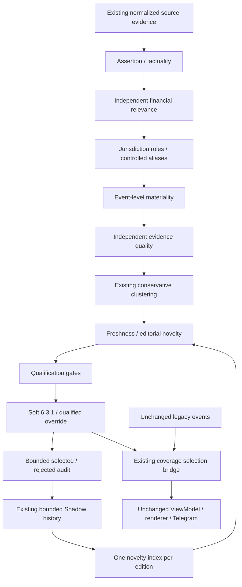

# Gate 2.4B — Editorial Intelligence Qualification Remediation

- Version: V3.1-alpha.2 / Gate 2.4B (local candidate only)
- Date: 2026-10-23
- Owner: Wilson / Fiona Product / Codex
- Baseline: ba52bcf4a32c43f836600c63a8df4a4205e3c071
- Local verdict: PASS WITH CONDITIONS; no commit, push, deployment or activation
- Parent Gate 2: OPEN / REMEDIATION REQUIRED; Gate 3: LOCKED
- Latest correction: Gate 2.4B.1; see the correction appendix for the current local verdict. Earlier comparisons remain historical wave evidence only.

## Objective and retrospective

Qualify intelligence before ranking, without changing production selection,
Scheduler, Ledger, Alerts, Telegram, locale, renderer, sources or infrastructure.
Read together with [Gate 2 implementation](GATE_2_IMPLEMENTATION.md),
[observability](GATE_2_1_SHADOW_EDITORIAL_OBSERVABILITY.md),
[Gate 2.2](GATE_2_2_EDITORIAL_QUALITY_REMEDIATION.md),
[state continuity](GATE_2_3_PRODUCTION_STATE_CONTINUITY.md),
[coverage specification](../FIONA_GLOBAL_COVERAGE_ENGINE.md),
[ADR 007](../../decisions/ADR_007_GLOBAL_EDITORIAL_COVERAGE_ARCHITECTURE.md),
[Product Freeze](../FIONA_V3_1_PRODUCT_FREEZE.md), and
[Release Strategy](../FIONA_V3_1_RELEASE_STRATEGY.md).

Seven retained production editions (October 17–23) contained 70 selected records:
GOOD 8, ACCEPTABLE 17, QUESTIONABLE 38, INCORRECT 7; GOOD+ACCEPTABLE=35.71%.
The review identified 9 regional conflicts, 2 ambiguous regions, 8 administrative
risks, 6 weak repeated slots and one false Fed override. These are subjective
editorial labels, not statistical model accuracy. The 498 qualified count is a
sum across editions, not 498 distinct events.

Gate 2.4A confirmed category fallback, source-market priors, substring matching,
quality/materiality coupling, conditional override and absent cross-edition
qualification. It did NOT recover historical snippets/category/markets or prove
the exact missing-summary trigger for every record. Current production already
removed publisher-region fallback; US/EU alias gaps and early region returns
were distinct remaining defects. This wave does not refetch historical content.

## Repository and release safety

Correct Desktop repository; main, local HEAD/origin/main/remote main all baseline
ba52bcf, ahead/behind 0/0. Three already-modified documents and 19 pre-existing
untracked entries were inventoried and preserved. In particular, do not include
the existing decision_log, Gate 2.3 continuity/incident edits, Word document,
historical drafts or prototype scripts in this wave. Decisions are recorded
here rather than editing the already-dirty decision log.

No production command, variable change, state migration, scheduled occurrence,
Alert activation or actual Telegram send is authorized. Railway remains on the
existing deployed baseline with photo/en-US/image, legacy coverage/cadence and
Delta off. Local tests of global_631 do not authorize activation.

## Architecture

`app/fiona_editorial.py` owns immutable typed decisions and pure deterministic
rules. `fiona_global_coverage` integrates them with normalization/clustering and
ranking. `fiona_coverage_runtime` loads the existing history BEFORE evaluation.
`fiona_shadow_audit` projects bounded evidence, not source bodies.

## Contracts and eligibility

### Financial relevance

DIRECT: an explicit financial, monetary, macro or market claim.
TRANSMITTED: a supported policy, shipping or systemic geopolitical risk channel.
CONTEXT_ONLY: background/routine content without standalone current significance.
NOT_RELEVANT: nonfinancial subject without a supported business result/channel.
UNKNOWN: insufficient event evidence; never promoted by publisher or quota.

Only DIRECT or TRANSMITTED with a channel can qualify. Decisions preserve class,
channels, controlled evidence references and reason. Source content categories
remain useful clustering metadata but no longer establish relevance/materiality.
An actual early-warning policy or stability channel need not wait for price
confirmation. Sports-club earnings are not banned because the subject is sports.

### Keyword and market evidence

English token/phrase boundaries replace substring market matching: Golden is
not gold, feds is not Fed, room rates are not policy rates. Source-supported
markets are retained separately; only event-supported markets contribute to
cross-market impact. Named markets are heuristic evidence mentions, not measured
proof that every named asset has already reacted. CJK geography uses bounded
controlled phrase matching; this is not a new translation or extraction service.

### Assertion and factuality

REALIZED_EVENT, ANNOUNCED_DECISION, REPORTED_OBSERVATION, EXPECTATION,
CONDITIONAL_SCENARIO, SPECULATION, UNKNOWN are distinct. Conditional/negative
markers are retained. Actor and action are captured where identifiable;
object/event_time/effective_time remain null when not supplied reliably.
Published time is NOT occurred/effective time. There is no inferred historical
timestamp. The verification field remains Unverified: grammatical assertion
classification and evidence quality do not establish Confirmed Fact.

An official, traceable financial publication may be recognized as a reported
publication even when its title is nominal; that is not proof of a new underlying
policy action. A future decision-date notice is routine, not an executed rate
decision. Negative policy statements may remain useful observations at lower
materiality. Expectations/scenarios remain eligible financial intelligence when
specific enough, but cannot use the realized-event override path.

### Independent evidence quality

Quality is a bounded heuristic sum independent of materiality:

| Component | Maximum / rule |
|---|---|
| Traceable article path | 20; no invented article URL in production |
| Source authority | Official/Primary 20; media tier 1/2/3 18/15/10 |
| Reliable publication timestamp | 15; absent/implausibly future gets zero |
| Specific evidence reference plus action/quantity | 20 |
| Assertion support | realized/announced/observed 20; expectation/scenario 12 |
| Independent corroboration | +8 per additional independent group, maximum15 |

Cap=100. An official single-source announcement can qualify. Owner/URL/copied
snippet grouping still prevents syndicated confirmation inflation. Corroboration
does NOT increase materiality. Quality is not a calibrated probability, source
truth certification or replacement for the future Governance Layer.

### Materiality and qualification order

Event evidence, not source category/tier, sets importance. Systemic events start
at92; supported rate action75; macro release70; material trade/regulatory/financial
rate signal65; supported transmission58; other specific financial claim40.
Exceptional measured crypto liquidation context is recognized. Actual surprise
adds10, bounded100. Cross-market breadth contributes12% using event markets only;
there is no default macro breadth floor. Administrative content18; unsupported
content lower. Expectations cap60, scenarios55, speculation30, unknown35, negated
actions55. These caps do not certify an event and cannot bypass qualification.

The existing M>=40 and Q>=50 floors remain. Unsupported assertion/relevance,
insufficient evidence, stale/missing time, empty title and unchanged selected
facts reject BEFORE regional scoring. A known prior event with changed wording
but no proven material follow-up is withheld. Missing historical baseline is
reported UNKNOWN and does not block all important otherwise-qualified events.

Ranking now uses 46% materiality,13% event breadth,15% freshness,18% independent
evidence quality,8% narrative heuristic. Raw tier and confirmation are not added
again. Regional adjustment remains [-1.2,+4.8], soft60/30/10, no hard quota.
At most10 selections, including overrides; fewer eligible events means fewer
selected records, with `selection_shortfall_reason`, not filler or legacy fallback.

### Evidence-qualified override

Requires relevance, supported non-negated assertion, traceable item, valid time,
quality>=70, materiality>=85 and explicit actual exceptional/surprise evidence.
It cannot bypass final freshness/eligibility. The pure score compatibility helper
has no provenance/time and therefore CANNOT authorize an override.
Eligible overrides are promoted within the same bounded selection, not a second
sender. Source authority adds no separate override score. An official source can
support an authentic single-source action; publication status is not multi-source
confirmation. Retained conditional Fed analysis no longer gets a +100 promotion.

## Geography

Preserve canonical US_EU/GREATER_CHINA/REST_OF_WORLD/GLOBAL/UNKNOWN. Record primary
jurisdiction, secondary regions, participants, controlled geographic evidence and
reason. Gather cross-region evidence rather than returning the first China match.
Uppercase US/EU aliases require token boundaries; lowercase English pronoun us
does not imply America. Official institutional identity may establish its own
jurisdiction, never publisher headquarters. US sanctions/Russia distinguish issuer
and target. Bab al-Mandeb is the shipping location, not China merely because China
speaks. Global crypto liquidation can be GLOBAL without invented US jurisdiction.
Cross-region and role heuristics remain limited; this is not a full entity graph.

## Novelty, persistence and failure policy

States: NEW_EVENT, UNCHANGED, MATERIAL_UPDATE, PERIODIC_NEW_OCCURRENCE, UNKNOWN.
An index is built once from selected records in the existing21-day Shadow history.
Family identity combines bounded normalized headline, actor/jurisdiction context
and explicit release-period treatment; it is not source-specific. Store hashes,
small quantitative evidence/outcome markers and assertion type, not article bodies.
Use aware time order; ignore future/out-of-retention entries. Distinct central
banks with generic official titles must not share a family by regional bucket.

Same facts across retrieval refresh or new publisher=UNCHANGED. Explicit changed
outcome/revised measurement can be MATERIAL_UPDATE, even for unchanged cluster_id.
Named new month/week/date/quarter can be PERIODIC_NEW_OCCURRENCE. Changed wording
alone, new publisher or raw retrieval timestamp is NOT material evidence. Negative
and hypothetical outcome markers cannot manufacture resolution. Source snippets
still contain claims, not independently verified outcomes.

History root schema remains3.1 for rollback compatibility and adds
editorial_state_version=gate2.4b. Writes use the existing atomic writer; retention
stays21days. Missing/legacy fingerprints yield UNKNOWN rather than invented prior
facts. Invalid/corrupt history is preserved, not overwritten/reset; important
events may still qualify with explicit unavailable-history status. This degrades
novelty protection and requires operator review; it is not durable exactly-once.
No second Ledger, database, scheduler state or Gate3 Delta namespace is created.

Known limitation: family identity is conservative lexical identity, not semantic
event resolution. Paraphrases/changed entities may evade matching. Unmarked
quantitative-only follow-ups without a supported revision/outcome may be withheld.
Material outcome extraction and ambiguous grammatical scopes require future
review; do not call this complete natural-language factuality or causality.

## Audit schema

Selected records add assertion decision, relevance/channels/reason, independent
quality/components, geographic decision, novelty, override eligibility, final
reason, versioned editorial memory, member IDs, publication timestamps, category
and event markets. The original bounded safe projection/redaction remains.
Up to20 highest-ranked unselected cluster headlines/reasons/scores are retained,
with a16,000-byte rejection-list budget and omission count. Some are eligible but
below capacity; distinguish that from an eligibility rejection. No full candidate
pool, bodies, private payloads, source URLs or credentials are logged.
Compact stdout has one additional bounded `fionaShadowRejectedCandidates` record
when needed, not one new log per candidate. Projection must not mutate selection.

## Corpus, evidence integrity and comparative experiment

`tests/fixtures/gate2_4b_historical_selected.json` contains70 retained headline/
source/score/region/override fields and original editorial labels (evidence A).
The comparison uses empty snippets plus explicitly synthetic item URLs/publication
at each evaluation time (assumption B), not recovered historical timestamps.
The30-case deterministic corpus is synthetic C, with expected eligibility,
assertion, relevance, region, novelty, override and reason. Dedicated workflows
cover unchanged editions, same-cluster material update, periodic release,
corroboration/syndication, corrupt state, caps, failure isolation and audit bounds.

The original pool beyond selected records is unavailable: NO complete historical
ranking replay, missed-event recall estimate, post-patch production acceptance or
new real-world source-health claim is made. An old INCORRECT label on the Fed case
referred to its false realized-event override; preserving a non-overridden
expectation does not automatically inherit or reverse that original label.

### Validation (local only)

- Focused Gate2.4B: 66 tests; full suite: 546 tests. Final executed results are
  recorded at wave completion; no failed assertion is hidden by a production edit.
- Compile uses temporary cache outside the repository; no production dependency
  installation. Existing native-photo/en-US, five briefs, Alert, Scheduler,
  Ledger/arbitration, source handling and selection-bridge regressions retained.
- Existing projection tests were updated for deliberately changed qualification
  semantics and one new rejected-summary log. Historical fixed rank digests are
  no longer valid expectations for a changed editorial engine; projection's
  non-mutation/order/score invariants remain independently checked.
- Generic ranking fixtures now contain explicit financial observations, not
  source/category-only assertions. Legacy payload/content comparisons unchanged.
- Offline coverage validator: 15 fixture candidates,4 qualified/selected clusters.
  Both real selection bridges render1440x1800 PNG: legacy265050bytes/global251849;
  caption391/376 chars, no CJK; Telegram calls0. Fixtures are NOT production news.
- Production Ledger/Alert/Shadow history mutations0; formal occurrences0;
  Railway variables changedNo. Tests use temporary local state only.
- The final full suite is also run with real socket connections forbidden;
  network connection attempts must remain0. Expected fault-injection messages
  in test stdout are not production failures.
- Synthetic600-event/30-cluster ranking with tracemalloc: baseline14.3280s,
  revised14.3763s, peak59028/59108bytes. This instrumented clustering-dominated
  microbenchmark excludes source I/O/rendering and does not predict production
  latency. No remote inference, infrastructure or unbounded cache added.

## False-negative risks and technical debt

Title-only tests may withhold valid official economic publications, policy speeches,
trade-finance background or geopolitical statements when actual claim details live
only in missing snippets. Limited controlled vocabulary and language support are
not a knowledge graph. A credible real snippet may change qualification; never
invent one to improve the retrospective percentage. Full-pool recall and blind
editorial review still need future post-release evidence. Existing clustering
heuristics and worst-case pairwise cost remain; this wave does not rewrite them.

## Decisions and rollback

1. Relevance/factuality are independent eligibility gates, not threshold inflation.
2. Quality measures evidence separately from economic importance.
3. Reuse existing Shadow history, do not use a delivery Ledger as content memory.
4. Fail uncertain on history gaps; preserve corrupt evidence and legacy delivery.
5. Keep selected count variable; regional supply cannot create eligibility.

No production rollback is needed for uncommitted local work. A future approved
release can revert this scoped patch; old code still reads schema3.1 and ignores
new fields. Keep the original history/Volume when rolling back; do not delete
state, reset Ledger or change Alert settings. Production coverage stays legacy.

## Completion and next gate

Local contract verification is PASS WITH CONDITIONS, not activation permission.
Conditions: Wilson/Product review relevance boundaries, false-negative examples,
and changed scoring meaning; subsequently authorize a precise commit/deployment
separately. Future real Shadow review must not use this training corpus as its
only acceptance dataset. Proposed independent review target: at least7 natural
post-patch editions, no obvious incorrect event/false override/systematic region
bias/weak repeat padding, substantial GOOD+ACCEPTABLE improvement (proposed90%).
Do not force70 items if qualified supply is lower; extend observation instead.
No Gate2 Closeout, V3.1GA, 4H cadence, 4H Delta or Gate3 work is authorized.

The before/after tables and final boundary below are generated from local fixtures.

## Complete selected-subset comparison (not full historical replay)

All old eligibility values are Yes because these were retained selections. Old
novelty is NOT_EVALUATED, not assumed NEW. M remains a heuristic; old Q and new
Evidence Q have different semantics and are not calibrated comparable units.
The new flags below use declared synthetic time/URL and empty-summary assumptions.

| Record | Old label | Eligible old/new | M old/new | Q old/Evidence Q new | Region old/new | Override old/new | New novelty | New rejection |
|---|---|---|---|---|---|---|---|---|
| 2026-10-17/1 | INCORRECT | Yes/Yes | 93/42 | 100/82 | US_EU/US_EU | true/false | NEW_EVENT | Qualified |
| 2026-10-17/2 | QUESTIONABLE | Yes/No | 73/18 | 85/95 | US_EU/US_EU | false/false | NEW_EVENT | financial_relevance: routine_without_material_change |
| 2026-10-17/3 | ACCEPTABLE | Yes/Yes | 78/42 | 85/80 | US_EU/US_EU | false/false | NEW_EVENT | Qualified |
| 2026-10-17/4 | ACCEPTABLE | Yes/No | 73/10 | 80/50 | REST_OF_WORLD/GLOBAL | false/false | NEW_EVENT | assertion: unsupported_or_speculative_assertion |
| 2026-10-17/5 | GOOD | Yes/Yes | 78/75 | 85/80 | GLOBAL/GLOBAL | false/false | NEW_EVENT | Qualified |
| 2026-10-17/6 | INCORRECT | Yes/No | 66/10 | 73/90 | UNKNOWN/US_EU | false/false | NEW_EVENT | financial_relevance: no_supported_financial_transmission |
| 2026-10-17/7 | GOOD | Yes/Yes | 77/94 | 84/80 | REST_OF_WORLD/REST_OF_WORLD | false/true | NEW_EVENT | Qualified |
| 2026-10-17/8 | GOOD | Yes/Yes | 77/77 | 80/85 | US_EU/GLOBAL | false/false | NEW_EVENT | Qualified |
| 2026-10-17/9 | ACCEPTABLE | Yes/Yes | 77/72 | 80/85 | US_EU/UNKNOWN | false/false | NEW_EVENT | Qualified |
| 2026-10-17/10 | ACCEPTABLE | Yes/No | 65/10 | 72/60 | REST_OF_WORLD/GLOBAL | false/false | NEW_EVENT | assertion: unsupported_or_speculative_assertion |
| 2026-10-18/1 | QUESTIONABLE | Yes/No | 73/18 | 85/95 | US_EU/US_EU | false/false | NEW_EVENT | financial_relevance: routine_without_material_change |
| 2026-10-18/2 | QUESTIONABLE | Yes/No | 78/25 | 85/80 | UNKNOWN/UNKNOWN | false/false | NEW_EVENT | financial_relevance: commentary_without_specific_new_event |
| 2026-10-18/3 | QUESTIONABLE | Yes/Yes | 73/65 | 80/90 | REST_OF_WORLD/GLOBAL | false/false | NEW_EVENT | Qualified |
| 2026-10-18/4 | ACCEPTABLE | Yes/No | 78/75 | 85/80 | GLOBAL/GLOBAL | false/false | UNCHANGED | novelty: unchanged_previous_selection |
| 2026-10-18/5 | QUESTIONABLE | Yes/No | 66/10 | 73/50 | GLOBAL/GLOBAL | false/false | NEW_EVENT | assertion: unsupported_or_speculative_assertion |
| 2026-10-18/6 | ACCEPTABLE | Yes/No | 77/94 | 84/80 | REST_OF_WORLD/REST_OF_WORLD | false/true | UNCHANGED | novelty: unchanged_previous_selection |
| 2026-10-18/7 | QUESTIONABLE | Yes/No | 48/25 | 60/65 | US_EU/US_EU | false/false | NEW_EVENT | assertion: unsupported_or_speculative_assertion |
| 2026-10-18/8 | INCORRECT | Yes/No | 48/18 | 60/75 | US_EU/US_EU | false/false | NEW_EVENT | assertion: unsupported_or_speculative_assertion |
| 2026-10-18/9 | QUESTIONABLE | Yes/No | 51/18 | 63/75 | REST_OF_WORLD/REST_OF_WORLD | false/false | NEW_EVENT | assertion: unsupported_or_speculative_assertion |
| 2026-10-18/10 | QUESTIONABLE | Yes/No | 48/10 | 55/50 | US_EU/US_EU | false/false | NEW_EVENT | assertion: unsupported_or_speculative_assertion |
| 2026-10-19/1 | QUESTIONABLE | Yes/No | 73/18 | 85/95 | US_EU/US_EU | false/false | NEW_EVENT | financial_relevance: routine_without_material_change |
| 2026-10-19/2 | ACCEPTABLE | Yes/No | 77/94 | 84/80 | REST_OF_WORLD/REST_OF_WORLD | false/true | UNCHANGED | novelty: unchanged_previous_selection |
| 2026-10-19/3 | QUESTIONABLE | Yes/No | 65/10 | 72/70 | UNKNOWN/REST_OF_WORLD | false/false | NEW_EVENT | financial_relevance: insufficient_event_evidence |
| 2026-10-19/4 | QUESTIONABLE | Yes/No | 51/25 | 58/82 | US_EU/US_EU | false/false | NEW_EVENT | financial_relevance: commentary_without_specific_new_event |
| 2026-10-19/5 | INCORRECT | Yes/No | 48/10 | 55/60 | GREATER_CHINA/GLOBAL | false/false | NEW_EVENT | assertion: unsupported_or_speculative_assertion |
| 2026-10-19/6 | QUESTIONABLE | Yes/No | 48/10 | 55/60 | US_EU/UNKNOWN | false/false | NEW_EVENT | assertion: unsupported_or_speculative_assertion |
| 2026-10-19/7 | QUESTIONABLE | Yes/No | 48/10 | 55/50 | US_EU/US_EU | false/false | NEW_EVENT | assertion: unsupported_or_speculative_assertion |
| 2026-10-19/8 | QUESTIONABLE | Yes/No | 47/25 | 54/60 | GREATER_CHINA/GLOBAL | false/false | NEW_EVENT | assertion: unsupported_or_speculative_assertion |
| 2026-10-19/9 | QUESTIONABLE | Yes/No | 48/25 | 60/65 | US_EU/US_EU | false/false | NEW_EVENT | assertion: unsupported_or_speculative_assertion |
| 2026-10-19/10 | QUESTIONABLE | Yes/No | 47/10 | 54/50 | GREATER_CHINA/UNKNOWN | false/false | NEW_EVENT | assertion: unsupported_or_speculative_assertion |
| 2026-10-20/1 | QUESTIONABLE | Yes/No | 73/18 | 85/95 | US_EU/US_EU | false/false | NEW_EVENT | financial_relevance: routine_without_material_change |
| 2026-10-20/2 | QUESTIONABLE | Yes/No | 66/25 | 73/80 | GREATER_CHINA/GLOBAL | false/false | NEW_EVENT | financial_relevance: no_new_supported_financial_development |
| 2026-10-20/3 | ACCEPTABLE | Yes/No | 65/10 | 72/70 | GLOBAL/GLOBAL | false/false | NEW_EVENT | financial_relevance: insufficient_event_evidence |
| 2026-10-20/4 | QUESTIONABLE | Yes/No | 48/10 | 60/75 | US_EU/US_EU | false/false | NEW_EVENT | financial_relevance: insufficient_event_evidence |
| 2026-10-20/5 | QUESTIONABLE | Yes/No | 48/18 | 60/65 | REST_OF_WORLD/REST_OF_WORLD | false/false | NEW_EVENT | assertion: unsupported_or_speculative_assertion |
| 2026-10-20/6 | QUESTIONABLE | Yes/No | 48/18 | 60/65 | REST_OF_WORLD/REST_OF_WORLD | false/false | NEW_EVENT | assertion: unsupported_or_speculative_assertion |
| 2026-10-20/7 | INCORRECT | Yes/No | 48/10 | 55/72 | US_EU/US_EU | false/false | NEW_EVENT | financial_relevance: no_supported_financial_transmission |
| 2026-10-20/8 | QUESTIONABLE | Yes/No | 48/18 | 60/65 | REST_OF_WORLD/REST_OF_WORLD | false/false | NEW_EVENT | assertion: unsupported_or_speculative_assertion |
| 2026-10-20/9 | QUESTIONABLE | Yes/No | 48/10 | 55/62 | US_EU/US_EU | false/false | NEW_EVENT | financial_relevance: insufficient_event_evidence |
| 2026-10-20/10 | QUESTIONABLE | Yes/No | 48/18 | 60/75 | REST_OF_WORLD/REST_OF_WORLD | false/false | NEW_EVENT | assertion: unsupported_or_speculative_assertion |
| 2026-10-21/1 | ACCEPTABLE | Yes/Yes | 47/65 | 59/95 | US_EU/US_EU | false/false | NEW_EVENT | Qualified |
| 2026-10-21/2 | GOOD | Yes/Yes | 57/42 | 64/80 | GREATER_CHINA/GREATER_CHINA | false/false | NEW_EVENT | Qualified |
| 2026-10-21/3 | QUESTIONABLE | Yes/No | 65/10 | 72/50 | GLOBAL/GLOBAL | false/false | NEW_EVENT | assertion: unsupported_or_speculative_assertion |
| 2026-10-21/4 | GOOD | Yes/Yes | 51/42 | 58/80 | REST_OF_WORLD/REST_OF_WORLD | false/false | NEW_EVENT | Qualified |
| 2026-10-21/5 | QUESTIONABLE | Yes/No | 48/25 | 60/65 | US_EU/US_EU | false/false | NEW_EVENT | assertion: unsupported_or_speculative_assertion |
| 2026-10-21/6 | INCORRECT | Yes/No | 51/10 | 58/72 | UNKNOWN/UNKNOWN | false/false | NEW_EVENT | financial_relevance: no_supported_financial_transmission |
| 2026-10-21/7 | QUESTIONABLE | Yes/No | 47/18 | 59/95 | GLOBAL/US_EU | false/false | NEW_EVENT | financial_relevance: routine_without_material_change |
| 2026-10-21/8 | QUESTIONABLE | Yes/No | 48/10 | 60/75 | US_EU/US_EU | false/false | NEW_EVENT | financial_relevance: insufficient_event_evidence |
| 2026-10-21/9 | ACCEPTABLE | Yes/Yes | 48/45 | 60/85 | GREATER_CHINA/GREATER_CHINA | false/false | NEW_EVENT | Qualified |
| 2026-10-21/10 | QUESTIONABLE | Yes/No | 48/25 | 55/60 | US_EU/US_EU | false/false | NEW_EVENT | assertion: unsupported_or_speculative_assertion |
| 2026-10-22/1 | QUESTIONABLE | Yes/Yes | 83/42 | 90/82 | US_EU/US_EU | false/false | NEW_EVENT | Qualified |
| 2026-10-22/2 | GOOD | Yes/Yes | 73/67 | 80/90 | UNKNOWN/UNKNOWN | false/false | NEW_EVENT | Qualified |
| 2026-10-22/3 | QUESTIONABLE | Yes/No | 65/25 | 72/60 | GREATER_CHINA/GLOBAL | false/false | NEW_EVENT | assertion: unsupported_or_speculative_assertion |
| 2026-10-22/4 | ACCEPTABLE | Yes/Yes | 51/45 | 58/80 | US_EU/US_EU | false/false | NEW_EVENT | Qualified |
| 2026-10-22/5 | ACCEPTABLE | Yes/No | 65/10 | 72/50 | REST_OF_WORLD/GLOBAL | false/false | NEW_EVENT | assertion: unsupported_or_speculative_assertion |
| 2026-10-22/6 | ACCEPTABLE | Yes/No | 51/10 | 58/50 | US_EU/UNKNOWN | false/false | NEW_EVENT | assertion: unsupported_or_speculative_assertion |
| 2026-10-22/7 | ACCEPTABLE | Yes/Yes | 48/42 | 60/95 | REST_OF_WORLD/REST_OF_WORLD | false/false | NEW_EVENT | Qualified |
| 2026-10-22/8 | ACCEPTABLE | Yes/Yes | 48/42 | 60/95 | US_EU/US_EU | false/false | NEW_EVENT | Qualified |
| 2026-10-22/9 | ACCEPTABLE | Yes/No | 48/25 | 60/65 | US_EU/US_EU | false/false | NEW_EVENT | assertion: unsupported_or_speculative_assertion |
| 2026-10-22/10 | QUESTIONABLE | Yes/No | 48/18 | 60/65 | REST_OF_WORLD/REST_OF_WORLD | false/false | NEW_EVENT | assertion: unsupported_or_speculative_assertion |
| 2026-10-23/7 | QUESTIONABLE | Yes/No | 75/25 | 82/60 | GREATER_CHINA/GLOBAL | false/false | NEW_EVENT | assertion: unsupported_or_speculative_assertion |
| 2026-10-23/8 | QUESTIONABLE | Yes/No | 65/35 | 72/60 | GREATER_CHINA/GLOBAL | false/false | NEW_EVENT | assertion: unsupported_or_speculative_assertion |
| 2026-10-23/9 | QUESTIONABLE | Yes/No | 48/25 | 60/65 | US_EU/US_EU | false/false | NEW_EVENT | assertion: unsupported_or_speculative_assertion |
| 2026-10-23/10 | QUESTIONABLE | Yes/No | 51/25 | 58/60 | REST_OF_WORLD/UNKNOWN | false/false | NEW_EVENT | assertion: unsupported_or_speculative_assertion |
| 2026-10-23/1 | QUESTIONABLE | Yes/No | 73/10 | 80/50 | GREATER_CHINA/GLOBAL | false/false | NEW_EVENT | assertion: unsupported_or_speculative_assertion |
| 2026-10-23/2 | QUESTIONABLE | Yes/No | 78/25 | 85/82 | UNKNOWN/UNKNOWN | false/false | NEW_EVENT | financial_relevance: commentary_without_specific_new_event |
| 2026-10-23/3 | GOOD | Yes/Yes | 78/77 | 90/95 | REST_OF_WORLD/REST_OF_WORLD | false/false | NEW_EVENT | Qualified |
| 2026-10-23/4 | INCORRECT | Yes/No | 72/10 | 79/60 | US_EU/US_EU | false/false | NEW_EVENT | assertion: unsupported_or_speculative_assertion |
| 2026-10-23/5 | GOOD | Yes/Yes | 78/70 | 85/90 | UNKNOWN/UNKNOWN | false/false | NEW_EVENT | Qualified |
| 2026-10-23/6 | ACCEPTABLE | Yes/No | 78/10 | 90/65 | REST_OF_WORLD/REST_OF_WORLD | false/false | NEW_EVENT | assertion: unsupported_or_speculative_assertion |

## Synthetic regression corpus (C)

Full original retained headlines are in the fixture JSON, not reconstructed snippets.
The following synthetic cases also include supported workflow context for novelty,
independence and periodic releases in the executable test. None represents live news.

| Case | Expected eligibility | Assertion | Relevance | Region | Novelty | Override | Reason |
|---|---|---|---|---|---|---|---|
| policy | true | ANNOUNCED_DECISION | DIRECT | US_EU | NEW_EVENT | false | An actual rate action is financial; ordinary cuts are not automatically exceptional. |
| official | true | ANNOUNCED_DECISION | DIRECT | US_EU | NEW_EVENT | false | Traceable single-source capital regulation need not have a second publisher. |
| macro | true | REPORTED_OBSERVATION | DIRECT | US_EU | NEW_EVENT | false | A reported inflation measurement with surprise language has direct macro relevance. |
| stability | true | ANNOUNCED_DECISION | DIRECT | US_EU | NEW_EVENT | true | Announced emergency liquidity action is material before a price response occurs. |
| liquidity | true | REALIZED_EVENT | DIRECT | UNKNOWN | NEW_EVENT | true | Reported systemic banking crisis has an explicit stability channel. |
| geopolitical | true | REALIZED_EVENT | TRANSMITTED | GLOBAL | NEW_EVENT | true | Realized war and energy disruption support an early-warning transmission channel. |
| nba | false | UNKNOWN | NOT_RELEVANT | UNKNOWN | NEW_EVENT | false | Player-season news has no business result or supported financial channel. |
| artwork | false | UNKNOWN | CONTEXT_ONLY | US_EU | NEW_EVENT | false | Currency artwork administration is not monetary policy. |
| personnel | false | UNKNOWN | CONTEXT_ONLY | UNKNOWN | NEW_EVENT | false | Routine personnel news lacks material financial evidence. |
| campaign | false | REPORTED_OBSERVATION | NOT_RELEVANT | US_EU | NEW_EVENT | false | Political campaign receipts are not capital-market flow evidence. |
| commentary | false | UNKNOWN | NOT_RELEVANT | UNKNOWN | NEW_EVENT | false | Media-style commentary supplies no financial development. |
| conditional | true | CONDITIONAL_SCENARIO | DIRECT | US_EU | NEW_EVENT | false | A rate scenario may inform expectations but cannot claim a realized surprise. |
| surprise | true | ANNOUNCED_DECISION | DIRECT | US_EU | NEW_EVENT | true | A traceable actual unexpected decision may earn material override. |
| negative | true | REPORTED_OBSERVATION | DIRECT | US_EU | NEW_EVENT | false | A negative rate statement is an observation, not an executed cut. |
| hotel | false | REPORTED_OBSERVATION | CONTEXT_ONLY | UNKNOWN | NEW_EVENT | false | Hotel room prices are not policy interest rates. |
| rates | true | ANNOUNCED_DECISION | DIRECT | US_EU | NEW_EVENT | false | An actual hold is a decision even when no rate changes. |
| gold | true | REPORTED_OBSERVATION | DIRECT | UNKNOWN | NEW_EVENT | false | Whole-word gold and observed price movement identify commodities. |
| bilateral | true | ANNOUNCED_DECISION | TRANSMITTED | GLOBAL | NEW_EVENT | false | A bilateral announcement preserves both jurisdictions. |
| euchina | true | ANNOUNCED_DECISION | TRANSMITTED | GLOBAL | NEW_EVENT | false | Tariff imposition is an announced trade measure across EU and China. |
| russia | true | ANNOUNCED_DECISION | TRANSMITTED | GLOBAL | NEW_EVENT | false | US policy issuer and Russian target must remain distinct. |
| crypto | true | REPORTED_OBSERVATION | DIRECT | GLOBAL | NEW_EVENT | false | Global liquidation evidence is not assigned a publisher's home region. |
| unchanged | false | ANNOUNCED_DECISION | DIRECT | US_EU | UNCHANGED | false | Same selected facts are not a new editorial development. |
| followup | true | REPORTED_OBSERVATION | DIRECT | US_EU | MATERIAL_UPDATE | false | Explicit revised quantitative evidence can update the same cluster. |
| periodic | true | REPORTED_OBSERVATION | DIRECT | US_EU | PERIODIC_NEW_OCCURRENCE | false | A named new release period is a separate occurrence, not retrieval refresh. |
| corroboration | true | ANNOUNCED_DECISION | DIRECT | REST_OF_WORLD | NEW_EVENT | false | Independent reports strengthen evidence, not economic importance. |
| syndication | true | ANNOUNCED_DECISION | DIRECT | GREATER_CHINA | NEW_EVENT | false | Shared ownership does not count as independent corroboration. |
| unknown_geo | true | REPORTED_OBSERVATION | DIRECT | UNKNOWN | NEW_EVENT | false | A market observation can be relevant without invented country attribution. |
| unknown_relevance | false | REPORTED_OBSERVATION | UNKNOWN | UNKNOWN | NEW_EVENT | false | Source identity alone cannot prove financial relevance. |
| override | true | ANNOUNCED_DECISION | DIRECT | US_EU | NEW_EVENT | true | A supported material regulatory ban may override a regional target. |
| weak_region | false | UNKNOWN | CONTEXT_ONLY | GREATER_CHINA | NEW_EVENT | false | An underweight region cannot rescue routine filler. |

### Interpretation

70 retained selections become 18 eligible title-probe records across seven restricted editions. All8 original
GOOD records remain eligible. Six nonfinancial INCORRECT cases are excluded;
the seventh, the Fed expectation analysis, loses its false override and remains
ordinary financial expectation intelligence at M42, not a realized decision.
The original subjective label is not silently relabeled to claim a new precision.
Two QUESTIONABLE items remain: the Russia sanctions waiver (region corrected,
financial transmission retained) and housing/Fed expectations (capped, no override).
Valid repeated broad-market/KOSPI reports without new facts are withheld. Several
ACCEPTABLE statements/background pieces remain uncertain without original snippets;
these potential false negatives are a Product Review condition, not a success rate.
Three title-probe KOSPI editions can show override eligibility at event level, but
only the first qualifies for selection; subsequent unchanged ones are rejected by
novelty. Thus event override eligibility is not delivery or selection authorization.

## Proposed release boundary and completion review

Intended source: app/fiona_editorial.py (new), app/fiona_global_coverage.py,
app/fiona_coverage_runtime.py, app/fiona_shadow_audit.py.

Intended tests: tests/test_fiona_gate2_4b.py (new),
tests/fixtures/gate2_4b_historical_selected.json (new),
tests/test_fiona_v3_1_gate2.py, tests/test_fiona_gate2_2.py,
tests/test_fiona_shadow_audit.py. Existing integration/transport/scheduler/Alert
contracts remain protected; updated fixtures test the deliberate new qualification
and bounded-log semantics, not old score snapshots.

Intended docs: this report, coverage specification, Gate2 implementation/Gate2.2
reference notes, V3 architecture snapshot, V3.1 roadmap/release strategy,
docs/VERSION_MATRIX.md and docs/changelog/CHANGELOG.md.

Exact documentation allowlist:

- docs/v3_1/gates/GATE_2_4B_EDITORIAL_QUALIFICATION.md
- docs/v3_1/FIONA_GLOBAL_COVERAGE_ENGINE.md
- docs/v3_1/gates/GATE_2_IMPLEMENTATION.md
- docs/v3_1/gates/GATE_2_2_EDITORIAL_QUALITY_REMEDIATION.md
- docs/v3/FIONA_ARCHITECTURE_SNAPSHOT_V3.md
- docs/v3_1/FIONA_V3_1_IMPLEMENTATION_ROADMAP.md
- docs/v3_1/FIONA_V3_1_RELEASE_STRATEGY.md
- docs/VERSION_MATRIX.md
- docs/changelog/CHANGELOG.md

The proposed boundary is18 files:4 added and14 modified. No `git add` was run.
No source registry/config/environment change. No unrelated README/PRD edits: the
Coverage specification is this wave's scoped product contract. Existing dirty
Decision Log and Gate2.3 records are preserved, not mixed into the release.

Exclude all pre-existing untracked entries, generated Word/prototype files,
reports/, tmp/, caches, PNGs, credentials and local outputs. Nothing is staged.

Final local verdict: PASS WITH CONDITIONS. Tests/compile and isolated renderer/
validator evidence meet local contracts; lexical generalization, candidate recall
and real post-patch editorial acceptance remain unproven. No production state,
code deployment, Railway variable or external delivery changed. Stop for Wilson.

## Gate 2.4B.1 Correction Appendix — Evidence-Aware Qualification & Novelty

- Date: 2026-10-23
- Owner: Wilson / Fiona Product / Codex
- Baseline HEAD / origin/main / GitHub main: `ba52bcf4a32c43f836600c63a8df4a4205e3c071`
- Branch: main; ahead/behind 0/0; pre-existing worktree dirty; staging empty.
- Previous release verdict: **PREFLIGHT BLOCKED**. The earlier local PASS WITH
  CONDITIONS and 18-event table above are prior-wave evidence, not release approval.
- Correction verdict: **PASS WITH CONDITIONS — local implementation only**.
- Parent Gate 2: OPEN / REMEDIATION REQUIRED. Gate 3 remains LOCKED.
- No staging, commit, push, Railway access/change/restart, deploy, real occurrence
  or Telegram send. Production authority is not changed or newly verified here.

### 1. Retrospective and reproduced defects

The original selected subset is 70 records: GOOD 8, ACCEPTABLE 17,
QUESTIONABLE 38, INCORRECT 7. Gate 2.4B's title probe retained 18:
GOOD 8/8, ACCEPTABLE 7/17, QUESTIONABLE 2, INCORRECT 1. Ten ACCEPTABLE
records were rejected. These are historical selected-event human labels,
**not production precision/recall**, and the candidate pool is unavailable.

Preflight established a material deterministic defect: a generic economic title
plus an explicit GDP/inflation/liquidity snippet remained UNKNOWN, whereas the
same snippet with a financial title became DIRECT. Assertion ignored snippets;
relevance mostly used title keywords; official-publication fallback required
relevance first and could not repair this. The prior comparison also generated
identical fact hashes from empty snippets and synthetic time/URL metadata:
that was not sufficient proof that later market sessions were unchanged.

The existing Gate 2.4B retrospective summarizes Gate 2.4A forensic findings.
No separate Gate 2.4A report was found in this checkout; this task does not invent
one or recover unavailable production article bodies. Gate 2.3 state continuity
and its unrelated local acceptance edits are preserved byte-for-byte.

### 2. Actual runtime evidence propagation

No source network request, LLM call, or new adapter was added.

| Stage | Actual code and evidence available |
|---|---|
| Legacy adapter | `wilson.fetch_rss` reads title, description/summary/content-encoded, link and published/updated text; `fetch_news` retains these in `RUN_CACHE["news_candidates"]` before presentation bucket truncation. |
| Runtime bridge | `fiona_runtime.run_once` passes `latest_news_candidates()` to the existing coverage-authority evaluator. This runtime file was not changed. |
| Legacy normalization | `normalize_legacy_candidates` passes the original dictionary to `normalize_source_item`; it does not replace the snippet with the headline. |
| Expanded adapters | `parse_rss_payload` and `parse_json_payload` retain the existing description/summary field, URL and publication metadata; `collect_source` normalizes each item. |
| Qualifier | `normalize_source_item` cleans title to 500 characters and snippet to 1,200, then calls `assess_event`. Publication parsing respects `original_published_at` when present; missing event time is not invented. |
| Member / representative | Members retain `source_provenance.original_text_snippet` and their editorial assessment. The existing cluster representative carries that assessment into eligibility and ranking; no second headline-only reclassification occurs. |
| Audit | `selected_event_audits` projects controlled decisions, hashes, counters and publication/session identity metadata, not full snippets, article bodies or URLs. Rejected audit remains bounded. |

Available event-specific metadata consists of source identity/tier/independence,
publication time, URL and the supplied claim text. There is no reliable generic
event-occurrence timestamp or structured trading-session field in these adapters.
Only an explicit session date in source claim text can supply a session key.
Fetch time is never an event-occurrence date. Adapter `updated` dates may reflect
publication revision, not a new financial event. No new metadata fetch is added.

Tests exercise both the real legacy RSS → candidate cache → normalizer path and
the expanded parser → collector → representative → audit path. Existing snippets
were reaching the qualifier; no collector/runtime propagation rewrite was needed.

### 3. Evidence-aware assertion and relevance contract

The correction is in `app/fiona_editorial.py`, with minimal normalization/history
integration in the existing coverage modules.

- Bounded source evidence: at most 1,200 snippet characters and 12 sentence/semicolon
  units. A unit needs a financial/economic subject and an observation, measurement,
  decision, or explicitly qualified scenario predicate. The word “market” alone,
  an acronym glossary, a metaphor, a publisher name, or source market priors cannot qualify.
- Generic title + actual reported observations can become REPORTED_OBSERVATION
  and DIRECT. A specific energy/shipping/bank-liquidity transmission may become
  TRANSMITTED. Incidental sports, campaign receipts, hospitality prices and
  administrative design meetings remain excluded without a genuine financial claim.
- Expectation, condition and speculation remain distinct from a decision.
  Explicit scenario context applies across sentences; uncertainty cannot authenticate
  an asserted surprise decision. Conflicting or mixed claims fail conservatively.
- A source denial/unchanged-rate observation contradicting a cut cannot receive a
  realized-action override. Reverse contradiction is UNKNOWN; the official-source
  publication fallback may not overwrite conflict/scenario evidence.
- Materiality and event-market inputs can use the selected supported source claim,
  rather than requiring the same keywords in a generic title. An unrelated GDP
  observation cannot authenticate an exceptional Fed action asserted only in a title.
- Source authority, traceability, timestamp quality and assertion support remain
  independent Evidence Q components, not a second Materiality score. Existing
  floors and maximum ten selections remain unchanged; no quota filling is introduced.
- Classification is deterministic source-claim analysis, **not independent fact
  verification**. `verification_status` is not promoted to Confirmed. Summary
  support does not itself prove real-world causality, truth, or cross-market impact.
- New decision references are controlled `source_claim:*` identifiers. Only hashes
  and typed identity metadata enter memory/audit; full claim text is not logged.
- Article publication time and event occurrence remain separate. Assertion event_time
  and effective_time remain null unless independently supplied; this patch invents neither.

### 4. Title / summary consistency controls

All additions in this table are **SYNTHETIC FIXTURE**, not recovered news.

| Pair | Expected and verified result |
|---|---|
| A: generic economic title, no snippet | Assertion UNKNOWN / relevance UNKNOWN; no forced NOT_RELEVANT and no selection. |
| B: same title, actual GDP contraction/inflation rise/liquidity fall statements | REPORTED_OBSERVATION / DIRECT; eligible when normal quality/freshness gates pass. |
| C: same detailed snippet, explicit financial title | Same assertion/relevance as B and substantially consistent materiality; both qualify. |
| D: generic title, incidental financial-sounding words | UNKNOWN or NOT_RELEVANT; glossary/metaphor/“market” mentions do not qualify. |
| E: explicit Fed decision title, analyst forecast/scenario-only evidence | EXPECTATION or CONDITIONAL_SCENARIO; no realized-event override. |
| F: rate-cut title contradicted by no cut / unchanged rates | Conservative observation with contradiction marker; no false cut override. Reverse conflict stays UNKNOWN. |

Justified differences: title-only context may remain unresolved; an actual source
claim can resolve a generic title, but a source prediction cannot upgrade a
prediction to fact. A separate unrelated macro observation may be relevant in its
own right but cannot validate the headline's claimed surprise decision.

### 5. Ten rejected ACCEPTABLE records: actual evidence and uncertainty

For every row below the **REAL HISTORICAL FIELD** set is the retained headline,
source_id, cluster_id, evaluation timestamp, old heuristic M/Q/region/override and
human label ACCEPTABLE. Missing in every row: original summary, original URL,
original publication/occurrence time, historical category/market evidence and full
candidate pool. Evaluation timestamps are not event-occurrence timestamps.

| Record / retained historical headline | Current stage / reason | Assessment under available evidence |
|---|---|---|
| 10/17–4: EU rallies around Zelensky as rift widens with Trump over Russia energy strikes | Assertion UNKNOWN; no supported financial consequence recovered | INCONCLUSIVE DUE TO MISSING EVIDENCE. Energy/security transmission is plausible; an actual oil-supply/shipping-cost snippet is separately tested, not reconstructed here. |
| 10/17–10: Zelensky asks EU for extra $79 billion to sustain Ukraine’s war effort | Assertion UNKNOWN; request is not approved funding or realized capital flow | INCONCLUSIVE DUE TO MISSING EVIDENCE. Fiscal relevance is possible; no approval, timing, yields response or actual funding is inferred. |
| 10/18–4: Asian stocks slip as China shares fall, oil risks and U.S. CPI weigh | Novelty UNKNOWN; material follow-up not established | INCONCLUSIVE DUE TO MISSING EVIDENCE. Financial relevance remains DIRECT; the original repeat conclusion cannot distinguish an old article from a new session. |
| 10/18–6: Asia stocks tumble as South Korea’s KOSPI triggers circuit breaker in tech rout | Novelty UNKNOWN; material follow-up not established | INCONCLUSIVE DUE TO MISSING EVIDENCE. A new circuit breaker remains possible, but is not asserted from the evaluation date. |
| 10/19–2: same KOSPI headline | Novelty UNKNOWN; material follow-up not established | INCONCLUSIVE DUE TO MISSING EVIDENCE. Reused cluster ID is not proof of identical occurrence. |
| 10/20–3: Chinese ambassador denies threatening Philippines after saying a war may prove easy to win | Financial relevance UNKNOWN; no demonstrated financial channel | JUSTIFIED REJECTION UNDER AVAILABLE EVIDENCE, not a verified historical irrelevance claim. A complete source could establish a transmission channel; current title alone does not. |
| 10/22–5: Putin says Russia to restart peace deal talks with US and Ukraine | Assertion UNKNOWN; talks statement is not an implemented settlement | INCONCLUSIVE DUE TO MISSING EVIDENCE. Energy, sanctions or policy transmission cannot be assumed. |
| 10/22–6: Goldman Sachs, JPMorgan and Morgan Stanley are dominating the AI stock boom. Here's their edge | Assertion UNKNOWN; no specific newly reported result recovered | JUSTIFIED REJECTION UNDER AVAILABLE EVIDENCE. The title appears analytical; actual new revenue, issuance or market data could change this with complete evidence. |
| 10/22–9: Piero Cipollone: Pontes and Appia: unlocking opportunities for banks | Assertion UNKNOWN / CONTEXT_ONLY; opportunity title alone is not a new decision | INCONCLUSIVE DUE TO MISSING EVIDENCE. A supplied actual settlement-platform/bond development now overrides the commentary-title presumption in a synthetic sensitivity test. |
| 10/23–6: Recent Economic Developments (October 2026) | Assertion UNKNOWN / relevance UNKNOWN in the empty-snippet probe | INCONCLUSIVE DUE TO MISSING EVIDENCE historically. The structural generic-title false negative is CONFIRMED by a separate complete-evidence control and fixed; the actual report contents remain unavailable. |

No historical summary was fabricated. The categories above describe current
evidence sufficiency, not a retrospective claim about the full article. There are
zero conclusively recovered historical false negatives; the confirmed defect is
a controlled semantic test. No requirement to force all ten through was used.

### 6. Novelty root cause, correction and conservative policy

The former comparator assigned an invented publication timestamp at each
evaluation and a fixture URL derived from cluster_id. It then hashed the same
headline + empty snippet into identical facts. The three Asian-equity/KOSPI
rejections therefore did **not** prove identical facts or identical actual sessions.
No evidence shows original source article IDs or publication timestamps for them.

The comparator now explicitly passes `RECONSTRUCTED_ASSUMPTION` provenance.
Identity memory stores an evidence-completeness flag, a hashed publication key,
an explicit source-session key when available, claim-presence booleans and the
existing fact/period/quantitative/development signatures. These are not a second
Ledger. Fetch timestamps are not factual changes.

| Evidence condition | Novelty and selection policy |
|---|---|
| Same source publication identity and identical retained facts | UNCHANGED; suppressed. |
| Same complete fact text, same original publication time, independent publisher | UNCHANGED; new publisher alone is not a new event. |
| Same cluster ID but actual new decision, supported outcome or material measured development | MATERIAL_UPDATE; normal gates still apply. |
| Same family with explicit different new trading session / circuit breaker | PERIODIC_NEW_OCCURRENCE; normal gates still apply. |
| Explicit new macro release period | PERIODIC_NEW_OCCURRENCE. |
| New fetch time only | Not a new development; unchanged retained publication remains suppressed. |
| Missing/reconstructed identity or older memory without evidence-completeness proof | UNKNOWN, not fabricated UNCHANGED. A known prior family is withheld pending material evidence. |
| Same headline, new publication timestamp but no proof of new occurrence | UNKNOWN; not automatic repetition permission. |
| Rewording, unsupported resolution, negated/conditional outcome or speculative numerical forecast | UNKNOWN; withheld for a known prior family. |
| Missing/corrupt entire history or unmatched legacy metadata | Existing initial UNKNOWN semantics retained; no reset of corrupt state, no automatic financial relevance promotion. |

For generic unexplained quantitative edits, a bounded heuristic ignores trivial
noise: changed like-for-like unit sets need at least 20% relative movement and
0.25 percentage points (percent) / 5 bps where applicable. Explicit actual
decisions and explicit data revisions are not subject to that generic noise
threshold. This is **not calibrated impact scoring**; units, metric alignment,
rounding and publisher wording still need real-source evaluation. Different
metric cardinalities without an explicit outcome remain uncertain. A small
revision test confirms the filter does not discard a reported macro revision.

The new identity schema is `gate2.4b.1`; the existing root state schema stays
3.1. The loader accepts old gate2.4b records without clearing or migrating state.
Old records lacking identity completeness yield UNKNOWN; actual production
history was neither read nor written. Corrupt history remains preserved.

### 7. Retained INCORRECT investigation

Retained historical headline:
“Analysis: Everyone expects the Fed to hold rates in October. Kevin Warsh could surprise us all”.

Actual retained evidence is only the selected-record field set listed above.
The Gate 2.4B reconstruction supplied an empty snippet and synthetic URL/time.
Its previous reconstructed result was EXPECTATION / DIRECT, M42 / Q82,
override false and eligible. Its original deployed M93/Q100/override true were
different historical values; they are not the corrected algorithm's measurements.

The previous correction removed the false realized-event override but still
allowed a speculative personality teaser without a specific new development.
This is a residual semantic defect **under the available title evidence**, not
proof of unseen article content. A general rule now marks an unanchored
could/may/might surprise/shock/stun teaser CONTEXT_ONLY when it supplies neither
a concrete scenario outcome nor a supported source claim. No exact-headline
blacklist is used. “Fed could surprise markets with a rate cut” remains a concrete,
capped conditional scenario, not a realized cut. An actual relevant source claim
can still supply eligibility. All seven original INCORRECT title probes now fail
selection; the two original QUESTIONABLE titles remain review risks.

The corrected reconstructed teaser result is EXPECTATION / CONTEXT_ONLY,
M25 / Evidence Q82, override false, selection false. This is not a claim about
the missing original article summary or independent fact verification.

### 8. Before / after selected-subset comparison

Evidence labels are deliberately distinct:

1. **REAL HISTORICAL FIELD**: the 70 retained headlines/identifiers/old labels and
   old selected-record metrics in the unchanged fixture JSON.
2. **RECONSTRUCTED ASSUMPTION**: both local qualification experiments use empty
   snippets and invented URL/publication metadata. The B.1 experiment marks the
   incompleteness explicitly. B and B.1 assertion/relevance/novelty columns below
   are local computed results, **not recovered historical classifications**.
3. **SYNTHETIC FIXTURE**: complete snippets, contradictory claims, explicit new
   sessions and new outcomes in isolated tests. They are never spliced into the
   70 historical records or represented as real reported facts.

| Original human label | Gate 2.4B eligible | Gate 2.4B.1 eligible |
|---|---:|---:|
| GOOD (8) | 8 | 8 |
| ACCEPTABLE (17) | 7 | 7 |
| QUESTIONABLE (38) | 2 | 2 |
| INCORRECT (7) | 1 | 0 |
| Total (70) | 18 | 17 |

ACCEPTABLE rejected remains 10/17. The goal is not increasing this retention
count without source evidence. The three prior repeat judgments become UNKNOWN,
not newly accepted. See the earlier complete historical-title table for each
record's full headline. The following is the complete 70-row local B/B.1 contract
comparison; unchanged rows are retained for review.

| Record | Original label | Eligible B/B.1 | Assertion B/B.1 | Relevance B/B.1 | Novelty B/B.1 | Meaningful change / current reason |
|---|---|---|---|---|---|---|
| 2026-10-17/1 | INCORRECT | true/false | EXPECTATION/EXPECTATION | DIRECT/CONTEXT_ONLY | NEW_EVENT/NEW_EVENT | Unanchored scenario teaser excluded; financial_relevance: speculative_teaser_without_specific_development |
| 2026-10-17/2 | QUESTIONABLE | false/false | ANNOUNCED_DECISION/ANNOUNCED_DECISION | CONTEXT_ONLY/CONTEXT_ONLY | NEW_EVENT/NEW_EVENT | No qualification change; financial_relevance: routine_without_material_change |
| 2026-10-17/3 | ACCEPTABLE | true/true | REPORTED_OBSERVATION/REPORTED_OBSERVATION | DIRECT/DIRECT | NEW_EVENT/NEW_EVENT | No qualification change |
| 2026-10-17/4 | ACCEPTABLE | false/false | UNKNOWN/UNKNOWN | UNKNOWN/UNKNOWN | NEW_EVENT/NEW_EVENT | No qualification change; assertion: unsupported_or_speculative_assertion |
| 2026-10-17/5 | GOOD | true/true | REPORTED_OBSERVATION/REPORTED_OBSERVATION | DIRECT/DIRECT | NEW_EVENT/NEW_EVENT | No qualification change |
| 2026-10-17/6 | INCORRECT | false/false | REPORTED_OBSERVATION/REPORTED_OBSERVATION | NOT_RELEVANT/NOT_RELEVANT | NEW_EVENT/NEW_EVENT | No qualification change; financial_relevance: no_supported_financial_transmission |
| 2026-10-17/7 | GOOD | true/true | REALIZED_EVENT/REALIZED_EVENT | DIRECT/DIRECT | NEW_EVENT/NEW_EVENT | No qualification change |
| 2026-10-17/8 | GOOD | true/true | REPORTED_OBSERVATION/REPORTED_OBSERVATION | DIRECT/DIRECT | NEW_EVENT/NEW_EVENT | No qualification change |
| 2026-10-17/9 | ACCEPTABLE | true/true | REPORTED_OBSERVATION/REPORTED_OBSERVATION | DIRECT/DIRECT | NEW_EVENT/NEW_EVENT | No qualification change |
| 2026-10-17/10 | ACCEPTABLE | false/false | UNKNOWN/UNKNOWN | UNKNOWN/UNKNOWN | NEW_EVENT/NEW_EVENT | No qualification change; assertion: unsupported_or_speculative_assertion |
| 2026-10-18/1 | QUESTIONABLE | false/false | ANNOUNCED_DECISION/ANNOUNCED_DECISION | CONTEXT_ONLY/CONTEXT_ONLY | NEW_EVENT/NEW_EVENT | No qualification change; financial_relevance: routine_without_material_change |
| 2026-10-18/2 | QUESTIONABLE | false/false | REPORTED_OBSERVATION/REPORTED_OBSERVATION | CONTEXT_ONLY/CONTEXT_ONLY | NEW_EVENT/NEW_EVENT | No qualification change; financial_relevance: commentary_without_specific_new_event |
| 2026-10-18/3 | QUESTIONABLE | true/true | ANNOUNCED_DECISION/ANNOUNCED_DECISION | TRANSMITTED/TRANSMITTED | NEW_EVENT/NEW_EVENT | No qualification change |
| 2026-10-18/4 | ACCEPTABLE | false/false | REPORTED_OBSERVATION/REPORTED_OBSERVATION | DIRECT/DIRECT | UNCHANGED/UNKNOWN | Reconstruction cannot prove unchanged; UNKNOWN remains withheld; novelty: material_follow_up_not_established |
| 2026-10-18/5 | QUESTIONABLE | false/false | UNKNOWN/UNKNOWN | UNKNOWN/UNKNOWN | NEW_EVENT/NEW_EVENT | No qualification change; assertion: unsupported_or_speculative_assertion |
| 2026-10-18/6 | ACCEPTABLE | false/false | REALIZED_EVENT/REALIZED_EVENT | DIRECT/DIRECT | UNCHANGED/UNKNOWN | Reconstruction cannot prove unchanged; UNKNOWN remains withheld; novelty: material_follow_up_not_established |
| 2026-10-18/7 | QUESTIONABLE | false/false | UNKNOWN/UNKNOWN | CONTEXT_ONLY/CONTEXT_ONLY | NEW_EVENT/NEW_EVENT | No qualification change; assertion: unsupported_or_speculative_assertion |
| 2026-10-18/8 | INCORRECT | false/false | UNKNOWN/UNKNOWN | CONTEXT_ONLY/CONTEXT_ONLY | NEW_EVENT/NEW_EVENT | No qualification change; assertion: unsupported_or_speculative_assertion |
| 2026-10-18/9 | QUESTIONABLE | false/false | UNKNOWN/UNKNOWN | CONTEXT_ONLY/CONTEXT_ONLY | NEW_EVENT/NEW_EVENT | No qualification change; assertion: unsupported_or_speculative_assertion |
| 2026-10-18/10 | QUESTIONABLE | false/false | UNKNOWN/UNKNOWN | UNKNOWN/UNKNOWN | NEW_EVENT/NEW_EVENT | No qualification change; assertion: unsupported_or_speculative_assertion |
| 2026-10-19/1 | QUESTIONABLE | false/false | ANNOUNCED_DECISION/ANNOUNCED_DECISION | CONTEXT_ONLY/CONTEXT_ONLY | NEW_EVENT/NEW_EVENT | No qualification change; financial_relevance: routine_without_material_change |
| 2026-10-19/2 | ACCEPTABLE | false/false | REALIZED_EVENT/REALIZED_EVENT | DIRECT/DIRECT | UNCHANGED/UNKNOWN | Reconstruction cannot prove unchanged; UNKNOWN remains withheld; novelty: material_follow_up_not_established |
| 2026-10-19/3 | QUESTIONABLE | false/false | REPORTED_OBSERVATION/REPORTED_OBSERVATION | UNKNOWN/UNKNOWN | NEW_EVENT/NEW_EVENT | No qualification change; financial_relevance: insufficient_event_evidence |
| 2026-10-19/4 | QUESTIONABLE | false/false | CONDITIONAL_SCENARIO/CONDITIONAL_SCENARIO | CONTEXT_ONLY/CONTEXT_ONLY | NEW_EVENT/NEW_EVENT | No qualification change; financial_relevance: commentary_without_specific_new_event |
| 2026-10-19/5 | INCORRECT | false/false | UNKNOWN/UNKNOWN | NOT_RELEVANT/NOT_RELEVANT | NEW_EVENT/NEW_EVENT | No qualification change; assertion: unsupported_or_speculative_assertion |
| 2026-10-19/6 | QUESTIONABLE | false/false | UNKNOWN/UNKNOWN | UNKNOWN/UNKNOWN | NEW_EVENT/NEW_EVENT | No qualification change; assertion: unsupported_or_speculative_assertion |
| 2026-10-19/7 | QUESTIONABLE | false/false | UNKNOWN/UNKNOWN | UNKNOWN/UNKNOWN | NEW_EVENT/NEW_EVENT | No qualification change; assertion: unsupported_or_speculative_assertion |
| 2026-10-19/8 | QUESTIONABLE | false/false | UNKNOWN/UNKNOWN | CONTEXT_ONLY/CONTEXT_ONLY | NEW_EVENT/NEW_EVENT | No qualification change; assertion: unsupported_or_speculative_assertion |
| 2026-10-19/9 | QUESTIONABLE | false/false | UNKNOWN/UNKNOWN | CONTEXT_ONLY/CONTEXT_ONLY | NEW_EVENT/NEW_EVENT | No qualification change; assertion: unsupported_or_speculative_assertion |
| 2026-10-19/10 | QUESTIONABLE | false/false | UNKNOWN/UNKNOWN | UNKNOWN/UNKNOWN | NEW_EVENT/NEW_EVENT | No qualification change; assertion: unsupported_or_speculative_assertion |
| 2026-10-20/1 | QUESTIONABLE | false/false | ANNOUNCED_DECISION/ANNOUNCED_DECISION | CONTEXT_ONLY/CONTEXT_ONLY | NEW_EVENT/NEW_EVENT | No qualification change; financial_relevance: routine_without_material_change |
| 2026-10-20/2 | QUESTIONABLE | false/false | REPORTED_OBSERVATION/REPORTED_OBSERVATION | CONTEXT_ONLY/CONTEXT_ONLY | NEW_EVENT/NEW_EVENT | No qualification change; financial_relevance: no_new_supported_financial_development |
| 2026-10-20/3 | ACCEPTABLE | false/false | REPORTED_OBSERVATION/REPORTED_OBSERVATION | UNKNOWN/UNKNOWN | NEW_EVENT/NEW_EVENT | No qualification change; financial_relevance: insufficient_event_evidence |
| 2026-10-20/4 | QUESTIONABLE | false/false | REPORTED_OBSERVATION/REPORTED_OBSERVATION | UNKNOWN/UNKNOWN | NEW_EVENT/NEW_EVENT | No qualification change; financial_relevance: insufficient_event_evidence |
| 2026-10-20/5 | QUESTIONABLE | false/false | UNKNOWN/UNKNOWN | CONTEXT_ONLY/CONTEXT_ONLY | NEW_EVENT/NEW_EVENT | No qualification change; assertion: unsupported_or_speculative_assertion |
| 2026-10-20/6 | QUESTIONABLE | false/false | UNKNOWN/UNKNOWN | CONTEXT_ONLY/CONTEXT_ONLY | NEW_EVENT/NEW_EVENT | No qualification change; assertion: unsupported_or_speculative_assertion |
| 2026-10-20/7 | INCORRECT | false/false | CONDITIONAL_SCENARIO/CONDITIONAL_SCENARIO | NOT_RELEVANT/NOT_RELEVANT | NEW_EVENT/NEW_EVENT | No qualification change; financial_relevance: no_supported_financial_transmission |
| 2026-10-20/8 | QUESTIONABLE | false/false | UNKNOWN/UNKNOWN | CONTEXT_ONLY/CONTEXT_ONLY | NEW_EVENT/NEW_EVENT | No qualification change; assertion: unsupported_or_speculative_assertion |
| 2026-10-20/9 | QUESTIONABLE | false/false | EXPECTATION/EXPECTATION | UNKNOWN/UNKNOWN | NEW_EVENT/NEW_EVENT | No qualification change; financial_relevance: insufficient_event_evidence |
| 2026-10-20/10 | QUESTIONABLE | false/false | UNKNOWN/UNKNOWN | CONTEXT_ONLY/CONTEXT_ONLY | NEW_EVENT/NEW_EVENT | No qualification change; assertion: unsupported_or_speculative_assertion |
| 2026-10-21/1 | ACCEPTABLE | true/true | ANNOUNCED_DECISION/ANNOUNCED_DECISION | DIRECT/DIRECT | NEW_EVENT/NEW_EVENT | No qualification change |
| 2026-10-21/2 | GOOD | true/true | REPORTED_OBSERVATION/REPORTED_OBSERVATION | DIRECT/DIRECT | NEW_EVENT/NEW_EVENT | No qualification change |
| 2026-10-21/3 | QUESTIONABLE | false/false | UNKNOWN/UNKNOWN | UNKNOWN/UNKNOWN | NEW_EVENT/NEW_EVENT | No qualification change; assertion: unsupported_or_speculative_assertion |
| 2026-10-21/4 | GOOD | true/true | REPORTED_OBSERVATION/REPORTED_OBSERVATION | DIRECT/DIRECT | NEW_EVENT/NEW_EVENT | No qualification change |
| 2026-10-21/5 | QUESTIONABLE | false/false | UNKNOWN/UNKNOWN | CONTEXT_ONLY/CONTEXT_ONLY | NEW_EVENT/NEW_EVENT | No qualification change; assertion: unsupported_or_speculative_assertion |
| 2026-10-21/6 | INCORRECT | false/false | CONDITIONAL_SCENARIO/CONDITIONAL_SCENARIO | NOT_RELEVANT/NOT_RELEVANT | NEW_EVENT/NEW_EVENT | No qualification change; financial_relevance: no_supported_financial_transmission |
| 2026-10-21/7 | QUESTIONABLE | false/false | REPORTED_OBSERVATION/REPORTED_OBSERVATION | CONTEXT_ONLY/CONTEXT_ONLY | NEW_EVENT/NEW_EVENT | No qualification change; financial_relevance: routine_without_material_change |
| 2026-10-21/8 | QUESTIONABLE | false/false | REPORTED_OBSERVATION/REPORTED_OBSERVATION | UNKNOWN/UNKNOWN | NEW_EVENT/NEW_EVENT | No qualification change; financial_relevance: insufficient_event_evidence |
| 2026-10-21/9 | ACCEPTABLE | true/true | REPORTED_OBSERVATION/REPORTED_OBSERVATION | DIRECT/DIRECT | NEW_EVENT/NEW_EVENT | No qualification change |
| 2026-10-21/10 | QUESTIONABLE | false/false | UNKNOWN/UNKNOWN | CONTEXT_ONLY/CONTEXT_ONLY | NEW_EVENT/NEW_EVENT | No qualification change; assertion: unsupported_or_speculative_assertion |
| 2026-10-22/1 | QUESTIONABLE | true/true | EXPECTATION/EXPECTATION | DIRECT/DIRECT | NEW_EVENT/NEW_EVENT | No qualification change |
| 2026-10-22/2 | GOOD | true/true | REPORTED_OBSERVATION/REPORTED_OBSERVATION | DIRECT/DIRECT | NEW_EVENT/NEW_EVENT | No qualification change |
| 2026-10-22/3 | QUESTIONABLE | false/false | UNKNOWN/UNKNOWN | CONTEXT_ONLY/CONTEXT_ONLY | NEW_EVENT/NEW_EVENT | No qualification change; assertion: unsupported_or_speculative_assertion |
| 2026-10-22/4 | ACCEPTABLE | true/true | REPORTED_OBSERVATION/REPORTED_OBSERVATION | DIRECT/DIRECT | NEW_EVENT/NEW_EVENT | No qualification change |
| 2026-10-22/5 | ACCEPTABLE | false/false | UNKNOWN/UNKNOWN | UNKNOWN/UNKNOWN | NEW_EVENT/NEW_EVENT | No qualification change; assertion: unsupported_or_speculative_assertion |
| 2026-10-22/6 | ACCEPTABLE | false/false | UNKNOWN/UNKNOWN | UNKNOWN/UNKNOWN | NEW_EVENT/NEW_EVENT | No qualification change; assertion: unsupported_or_speculative_assertion |
| 2026-10-22/7 | ACCEPTABLE | true/true | REPORTED_OBSERVATION/REPORTED_OBSERVATION | DIRECT/DIRECT | NEW_EVENT/NEW_EVENT | No qualification change |
| 2026-10-22/8 | ACCEPTABLE | true/true | REPORTED_OBSERVATION/REPORTED_OBSERVATION | DIRECT/DIRECT | NEW_EVENT/NEW_EVENT | No qualification change |
| 2026-10-22/9 | ACCEPTABLE | false/false | UNKNOWN/UNKNOWN | CONTEXT_ONLY/CONTEXT_ONLY | NEW_EVENT/NEW_EVENT | No qualification change; assertion: unsupported_or_speculative_assertion |
| 2026-10-22/10 | QUESTIONABLE | false/false | UNKNOWN/UNKNOWN | CONTEXT_ONLY/CONTEXT_ONLY | NEW_EVENT/NEW_EVENT | No qualification change; assertion: unsupported_or_speculative_assertion |
| 2026-10-23/7 | QUESTIONABLE | false/false | UNKNOWN/UNKNOWN | CONTEXT_ONLY/CONTEXT_ONLY | NEW_EVENT/NEW_EVENT | No qualification change; assertion: unsupported_or_speculative_assertion |
| 2026-10-23/8 | QUESTIONABLE | false/false | UNKNOWN/UNKNOWN | TRANSMITTED/TRANSMITTED | NEW_EVENT/NEW_EVENT | No qualification change; assertion: unsupported_or_speculative_assertion |
| 2026-10-23/9 | QUESTIONABLE | false/false | UNKNOWN/UNKNOWN | CONTEXT_ONLY/CONTEXT_ONLY | NEW_EVENT/NEW_EVENT | No qualification change; assertion: unsupported_or_speculative_assertion |
| 2026-10-23/10 | QUESTIONABLE | false/false | UNKNOWN/UNKNOWN | CONTEXT_ONLY/CONTEXT_ONLY | NEW_EVENT/NEW_EVENT | No qualification change; assertion: unsupported_or_speculative_assertion |
| 2026-10-23/1 | QUESTIONABLE | false/false | UNKNOWN/UNKNOWN | UNKNOWN/UNKNOWN | NEW_EVENT/NEW_EVENT | No qualification change; assertion: unsupported_or_speculative_assertion |
| 2026-10-23/2 | QUESTIONABLE | false/false | EXPECTATION/EXPECTATION | CONTEXT_ONLY/CONTEXT_ONLY | NEW_EVENT/NEW_EVENT | No qualification change; financial_relevance: commentary_without_specific_new_event |
| 2026-10-23/3 | GOOD | true/true | ANNOUNCED_DECISION/ANNOUNCED_DECISION | DIRECT/DIRECT | NEW_EVENT/NEW_EVENT | No qualification change |
| 2026-10-23/4 | INCORRECT | false/false | UNKNOWN/UNKNOWN | NOT_RELEVANT/NOT_RELEVANT | NEW_EVENT/NEW_EVENT | No qualification change; assertion: unsupported_or_speculative_assertion |
| 2026-10-23/5 | GOOD | true/true | REPORTED_OBSERVATION/REPORTED_OBSERVATION | DIRECT/DIRECT | NEW_EVENT/NEW_EVENT | No qualification change |
| 2026-10-23/6 | ACCEPTABLE | false/false | UNKNOWN/UNKNOWN | UNKNOWN/UNKNOWN | NEW_EVENT/NEW_EVENT | No qualification change; assertion: unsupported_or_speculative_assertion |

### 9. Validation and safety evidence

- Focused suite: **101 PASS**, including 35 additional correction tests; the
  original 66 tests remain present. Full repository: **581 PASS**.
- All deterministic tests ran with socket connection blocked; observed network
  attempts **0**. Expected injected journal/scheduler failure messages in negative
  tests are not production errors. No existing test was weakened to conceal failure.
- Compile: app/tests PASS, bytecode redirected to a temporary cache outside the
  repository.
- Existing suites exercise legacy selection byte regression, global_631 local
  selection, source health, selected/rejected audit sanitization and bounds,
  Scheduler/Ledger/arbitration, Alert deduplication, Native Photo and en-US.
- Dedicated stateless fixture validator: 15 candidate items, 1 qualified cluster,
  1 selected cluster (deliberately same supplied macro snippet across publishers).
  This is an offline isolation check, not live source diversity or production recall.
- Guarded state/delivery functions observed 0 calls: atomic state writer, memory
  save, Scheduler Ledger save, Shadow history save, Telegram request and classified
  media request. No production Scheduler/Alert/Shadow writes, Telegram API calls
  or formal occurrences were created.
- Pure authority tests retain legacy authority and validate a local global_631
  projection without environment activation, a second renderer, delivery or state
  writes. Other full-suite state tests use temporary fixtures and fake runners,
  not formal production occurrences.
- Runtime, Scheduler, Ledger, arbitration, Alert, Telegram, source registry,
  renderer and environment/configuration files are not changed by this correction.
  No Railway command, restart/deploy or variable mutation was performed.

### 10. Files, boundaries, risks and next review

This correction modifies only five already-in-scope files:

- `app/fiona_editorial.py`: bounded evidence-aware assertions/relevance,
  conservative conflict handling, actual claim-based materiality, identity/novelty.
- `app/fiona_global_coverage.py`: propagate declared reconstruction provenance;
  emit shared editorial-rule version.
- `app/fiona_coverage_runtime.py`: accept old/new editorial memory version without
  resetting history; shared version in audit metadata.
- `tests/test_fiona_gate2_4b.py`: 35 additional isolated tests and explicitly
  marked historical reconstruction; no historical source body additions.
- This report: correction appendix, uncertainties and complete local comparison.

No new file is required beyond the previously proposed **18-file whitelist**.
Other Gate 2.4B source/test/docs changes remain as pre-existing local work.
Pre-existing unrelated decision log, Gate 2.3 continuity/incident changes,
untracked documents, Word file and prototype scripts are preserved.
Roadmap, Release Strategy, Version Matrix and Changelog were not rewritten in
this correction; they retain their earlier uncommitted Gate 2.4B changes.
Nothing is staged and nothing is authorized for release by this local result.

Remaining risks/conditions: English lexical coverage, bounded/truncated summaries,
ambiguous multi-claim scope, source truth not independently verified, entity/metric
alignment of quantitative signatures, incomplete publication/session metadata,
unchanged weak repeats with missing history, and conservative withholding when
prior metadata cannot establish a genuine follow-up. No embedding, new clustering
architecture, LLM, new network source, Gate 3 cadence or Delta was introduced.

Next: Wilson/Product review this appendix and sensitivity controls, then issue a
separate controlled release preflight if approved. Actual post-patch Shadow
editorial acceptance and production/source recall remain unverified. Do not
claim production remediation, activate global_631, close Gate 2 or start Gate 3.

## Controlled Shadow Release Preflight — 2026-10-24 (UTC+8)

This dated entry supersedes earlier local-only authorization statements for this
release step. It does not overwrite historical experiment results or assert that
deployment has already succeeded.

### Release decision

**Pre-release verdict: PASS.** Wilson authorized one controlled Shadow-only
release after all mandatory gates pass. This permits precisely staging the
reviewed boundary, one commit and a normal main push; it does not permit global
coverage activation, a variable change, a manual redeploy or Gate 3.

Repository main / HEAD / origin/main / GitHub main were reverified at
ba52bcf4a32c43f836600c63a8df4a4205e3c071, ahead/behind 0/0. Staging was empty.
Three unrelated modified documents and all unrelated untracked files remain
excluded and unchanged. No new business correction was made during this release
preparation; only in-boundary release documentation was aligned.

### Current revalidation, not prior-wave test claims

- Compile app/tests PASS; focused editorial suite 101/101 PASS; full suite
  581/581 PASS. Full suite ran with socket connections blocked: attempts 0.
- Integrated RSS adapter → candidate cache → normalization → representative /
  qualifier experiment: A empty generic report stays UNKNOWN/unselected;
  B detailed supplied observations become REPORTED_OBSERVATION/DIRECT/selected;
  C the same observations with explicit financial title have the same outcome.
  Snippets were verified present in both cache and normalized provenance.
- Nine explicit negative controls (athlete, campaign fundraising, personality
  commentary, artwork meeting, individual crime, award, hospitality prices,
  Golden and feds) remain unselected. The original Fed analysis has no realized
  override; actual major monetary decisions and concrete conditional intelligence
  retain their tested distinct behavior.
- Novelty controls: ECB identical evidence UNCHANGED/unselected; Asian equity
  measured deterioration MATERIAL_UPDATE/selected; a separate explicitly dated
  KOSPI session PERIODIC_NEW_OCCURRENCE/selected. Routine bank enforcement
  termination notices are excluded at financial qualification, not admitted
  merely because no previous selected family exists.
- Historical title probe still retains GOOD 8, ACCEPTABLE 7, QUESTIONABLE 2,
  INCORRECT 0. The three incomplete historical repeat judgments are UNKNOWN.
  This is not historical production recall/precision or proof about missing bodies.
- Production-safe validator and pure bridge checks pass; guarded atomic writer,
  memory save, Scheduler Ledger save, Shadow history save, Telegram request and
  classified media request counters are all 0. No production Alert writes,
  formal occurrences, network fetches or Telegram sends occurred in these checks.
- Existing full-suite Native Photo/en-US, Scheduler/Ledger/Alert, legacy selection,
  local global_631, geography, independence and bounded audit regressions pass.
  Collector/source registry, renderer, Runtime, delivery and production
  configuration files remain outside the patch.

### Performance and bounded audit

In-memory comparison against the deployed HEAD module, 300 synthetic candidates,
one deliberately shared cluster, median of three normalization/evaluation runs:
baseline 0.9783 seconds, candidate 1.0302 seconds, ratio 1.053 (+5.3%).
Ranking-only traced peak allocations: 66,944 versus 69,488 bytes (+2,544 bytes).
This is a local microbenchmark, not a production latency/RAM SLA, worst-case
clustering benchmark or real-source comparison. No remote inference is added.

Source snippets remain bounded to 1,200 characters/12 units; normal collection
limits are unchanged. Novelty indexes the retained 21-day history once per edition
and at most 50 selected audit records per stored edition. No new unbounded history
namespace is introduced. Selection remains at most ten, with fewer allowed and no
regional filler. Selected projections remain bounded; at most 20 rejected
candidate summaries with a 16,000-byte list budget and omission counts. These are
safe headline/decision projections, not raw article summaries or bodies. Secret
pattern scan of the exact release files found no credential literal.

### Authorized read-only production baseline

- Railway project actual display name: astonishing-nurturing.
- Production environment: ba8f2bed-6655-448d-880a-4e984e61c9e7.
- Service: fiona-intelligence-system, 45da375b-2330-41c5-b235-74c7ff565b07.
- Deployment: 2b869668-5072-4bf7-b791-4ffc00f9b08e, SUCCESS;
  source commit ba52bcf4a32c43f836600c63a8df4a4205e3c071.
- Exactly one RUNNING instance observed:
  8e907340-557b-4e49-9eda-cc851a4db174.
- Existing Volume dab25017-c3fd-421b-b35d-06de42461154, mount /data, READY.
- Six natural cycles 3999–4004 had ok=true, persistent_loaded,
  ledger_load_error=null and errors=[]; the 20:30 Evening succeeded once.
- Fresh pre-commit read confirms cycle4044 completed the genuine
  market_news:2026-10-24T00:00:00+08:00 occurrence successfully at
  2026-10-24 00:01:42 UTC+8. Ledger path /data/fiona/scheduler/ledger.json;
  persistent_loaded, errors=[], ledger_load_error=null. It is finished, not an
  in-flight occurrence to interrupt.
- That pre-release Market News had configured_coverage_profile=legacy,
  selection_authority=legacy, photo/en-US/image, render_success=true,
  image_sent=true, text_sent=false, cleanup_state=success, no fallback,
  final_delivery_channel=photo, message_id2754.
  This is old-release baseline evidence, NOT the first revised Shadow.
- Actual allowed nonsecret variables: media photo, locale en-US, card mode image.
  Coverage/cadence/delta keys are unset: deployed default/code yields legacy /
  fixed legacy cadence / Delta off. No explicit flags will be added or changed.
- Runtime Alert compatibility aliases are already enabled/live; they are preserved,
  not newly enabled by this task. Every persistent_loaded cycle validates both
  runtime and standalone Alert memory as well as Scheduler state. The standalone
  default flag remains distinct; no Alert state or threshold is changed.
- The prior duplicate Evening incident has documented Gate2.3 live remediation.
  Recent observed Evening/Market News results contain no repeated successful ID.
  This is bounded log evidence, not a claim of distributed exactly-once or a
  complete historical Ledger dump.

Bulk log access timed out; smaller time-bounded authorized reads recovered the
required natural occurrence evidence. No token, raw variable dump, article body
or state-file snapshot was printed/stored in this release. No SSH permission
bypass, key creation, restore, state reinitialization or Volume reset was used.

### Exact approved 18-file boundary

- `app/fiona_editorial.py`
- `app/fiona_global_coverage.py`
- `app/fiona_coverage_runtime.py`
- `app/fiona_shadow_audit.py`
- `tests/test_fiona_gate2_4b.py`
- `tests/fixtures/gate2_4b_historical_selected.json`
- `tests/test_fiona_v3_1_gate2.py`
- `tests/test_fiona_gate2_2.py`
- `tests/test_fiona_shadow_audit.py`
- `docs/v3_1/gates/GATE_2_4B_EDITORIAL_QUALIFICATION.md`
- `docs/v3_1/FIONA_GLOBAL_COVERAGE_ENGINE.md`
- `docs/v3_1/gates/GATE_2_IMPLEMENTATION.md`
- `docs/v3_1/gates/GATE_2_2_EDITORIAL_QUALITY_REMEDIATION.md`
- `docs/v3/FIONA_ARCHITECTURE_SNAPSHOT_V3.md`
- `docs/v3_1/FIONA_V3_1_IMPLEMENTATION_ROADMAP.md`
- `docs/v3_1/FIONA_V3_1_RELEASE_STRATEGY.md`
- `docs/VERSION_MATRIX.md`
- `docs/changelog/CHANGELOG.md`

Four additions, fourteen modifications versus HEAD. Exclude the already-dirty
decision log, Gate2.3 continuity report, duplicate incident record, all unrelated
untracked docs/prototypes, reports, images, raw bodies, credentials and state.
No git add .; no reset/stash/clean. Compare unrelated file fingerprints before
and after the operation.

### Deployment acceptance and rollback contract

Only normal push of the one reviewed commit may trigger the automatic Railway
deployment. Verify actual deployment commit, SUCCESS, one RUNNING instance,
the same READY Volume, persistent_loaded, healthy Alert memories and subsequent
natural cycles. Do not manually redeploy if automatic deployment is absent.

Production must continue legacy/photo/en-US/image, legacy cadence and Delta off.
No new sender/renderer/Ledger is introduced. The completed midnight Market News
must not be replayed after replacement. A post-release natural Shadow may be
PENDING; do not create a synthetic occurrence or reuse the old baseline run as
acceptance of new code.

After actual safety acceptance only, target status is DEPLOYED / REVISED SHADOW
ACCEPTANCE PENDING, parent OPEN / EDITORIAL VALIDATION PENDING, Gate3 LOCKED.
This entry records release preparation, not a fabricated deployment outcome.
If a serious runtime/delivery regression occurs, stop, retain all state and report
the exact occurrence/deployment. Reverting the scoped release must preserve the
existing Volume, manifest, Scheduler Ledger, journals and Alert memories; do not
revert the durable-state baseline or initialize blank production state.
